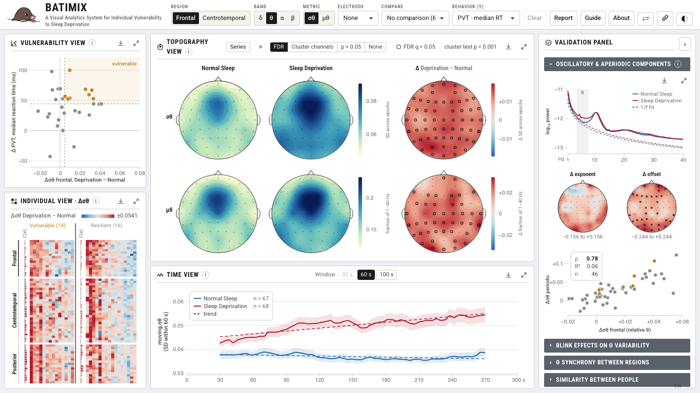

# BATIMIX: One sleepless night does not affect everyone the same way (Week 12)

Refined draft and peer-critique response. A linked D3.js explorer, **in a single view with a single header**, of individual vulnerability to sleep deprivation in resting-state EEG (OpenNeuro ds004902, 68 people with paired EEG). Three columns of boxed views, each with a short uppercase name and icon, in the style of IEEE VIS/TVCG visual analytics systems (VISTA, Unlearning Comparator): in the center, the Topography View (2 × 3 topomap matrix, the main view) with the Time View below (moving σθ or μθ per epoch); on the left, the people (Vulnerability View: scatter; Individual View: person × electrode heatmap); on the right, the collapsible Validation Panel with two robustness checks, «Oscillatory & aperiodic components» (specparam) and «Blink effects on θ variability», and one exploratory view, «θ synchrony between regions» (wPLI). No subtitles or instruction text sit over the charts: each view has an ⓘ icon next to its name with the reading and the figures, and legends live in boxes inside the charts that can be dragged or collapsed. Hovering any person shows their EEG quality (epochs used, interpolated channels, blinks). Preprocessing: average reference and ICA (`tools/eeg_ica.py`), as in the sleep-deprivation EEG literature. The 896-analysis multiverse (with the preprocessing pipeline as a dimension) is kept as a robustness analysis in About, in the Report and in `RefinedDraftReport.md` (section 4).

- **Application:** [`app/index.html`](app/index.html), with a light theme (classic, default) or a dark theme (instrument) from the ◐ button in the header; direct links with `?theme=light` or `?theme=dark`
- **Deployment (GitHub Pages):** https://andrea-coa.github.io/data-visualization-project/deliveries/week12/app/ (verify after the push; see "Deployment")
- **Project page:** [`project/index.html`](project/index.html)
- **Team:** Jimena Gurbillon, Andrea Coa, Paolo Medrano · DS5343 Data Visualization, UTEC 2026-2

> **Correction, 15 November 2026:** `ses-1` of ds004902 is always normal sleep and `ses-2` always deprivation; the pipeline had swapped them for the 28 people deprived first. Fixed in `app/tools/eeg_ica.py` (`session_to_condition`), all data regenerated and every figure recomputed: deprivation now raises theta variability at every electrode. Details: [`research/correccion_sesiones.md`](research/correccion_sesiones.md).




## Folder contents

```
deliveries/week12/
  README.md                      this file
  RefinedDraftReport.md          narrative, design rationale, findings, limitations and remaining work
  PeerCritiqueResponse.pdf       feedback received and the response to each suggestion (source: PeerCritiqueResponse.html)
  PresentationWeek12.pptx        presentation of the week
  paper/                         initial paper draft: source (HTML) and PDF
  project/                       initial project page
  app/                           code of the refined application
    index.html                   single view: header with controls, three columns and the About panel
    css/styles.css               light and dark themes (color and type tokens; dark is the base, light uses data-theme="light"), boxed views with gutters, Roboto and Roboto Condensed
    js/core.js                   data, state, event bus, groups, selection, statistics, electrode regions, floating legend boxes
    js/topomap.js                2 × 3 topomap matrix (EEGLAB/FieldTrip v4 interpolation; contours, p and FDR, σθ/μθ rows or two people); a chosen time window; the Series of Δ maps in time blocks
    js/scatter.js                Vulnerability View: scatter, «vulnerable» quadrant, lasso, click selection, A and B, legend box, data table
    js/dynamics.js               Time View: with μθ, mean ± SE per epoch; with σθ, moving σθ in windows of the chosen length (32, 60 or 100 s); click to pick a window; ▶ playback; block edges of the Series
    js/individuals.js            Individual View: person × electrode heatmap with two behavior-defined groups and their consistency C(e)
    js/secondary.js              Validation Panel: oscillatory & aperiodic components (spectrum with click-to-zoom θ band, Δ exponent and offset, Δσθ periodic with ρ, R² and n), blink check and θ synchrony (wPLI graph and effect per pair)
    js/report.js                 downloadable report (self-contained HTML with the view, how to read each chart, and CSV)
    js/main.js                   data loading, controls (including the Electrode selector) and start-up
    data/*.json                  final processed data for theta (and data.js to open the page by double-click; theta only)
    data/bands/<band>/*.json     delta, alpha and beta: topo, topo_by_subject, subject_epochs, electrode_epochs and participants_eeg (loaded when the band is chosen)
    tools/eeg_ica.py             shared EEG cleaning: notebook 02 + average reference + ICA (ocular and muscle) + 200 µV rejection; session → condition (ses-1 = NS, ses-2 = SD); dataset path (BATIMIX_DS); Welch in seconds; band edges (BANDS)
    tools/build_eeg_ica.py       main pipeline: generates ../data/processed_ica/*.csv from the raw EEG (same columns as Week 6), and ../data/processed_ica/bands/<band>/ for delta, alpha and beta in the same pass
    tools/build_participants.py  generates data/participants.json (EEG fields), data/subject_epochs.json, data/electrode_epochs.json (per-electrode epoch series for the time view) and ../data/participants_deltas.csv
    tools/build_multiverse.py    generates data/multiverse.json and ../data/multiverse_specs.csv (896 analyses, 2000 permutations)
    tools/crossover.py           crossover analysis by session order: data/crossover.json (deprivation effect c and visit effect π per electrode, region and band; behavior); --validate checks it on synthetic data
    tools/build_multiverse_bands.py  band as a multiverse dimension: data/multiverse_bands.json and ../data/multiverse_bands_specs.csv (2240 analyses: theta 896 with both pipelines, delta, alpha and beta 448 each with the main one; the same 2000 permutations for every band)
    tools/build_subject_topo.py  generates data/topo_by_subject.json
    tools/build_coords.py        generates data/coords.json (2D) and data/coords3d.json (3D) from electrodes.tsv
    tools/build_topo_stats.py    generates data/topo.json: NS, SD, Δ, paired t, d_z and 95% CI per electrode (68 paired people)
    tools/build_secondary.py     generates data/aperiodic.json (specparam) and data/connectivity.json (wPLI) from the raw EEG
    tools/build_quality.py       generates data/quality.json: per-person EEG quality and the blink check of σθ (raw EEG)
    tools/build_cui_variant.py   generates data/cui_variant.json: σθ with an ICA pipeline in the style of Cui et al. (raw EEG)
    tools/check_app.py           technical tests: statistics, per-electrode effects, reference signals, consistency, secondary views, screenshots
    tools/selftest.html          page used by check_app.py to read what the app computes and shows
    tools/check_reproduction.py  reproduces the processed CSVs from the raw EEG (notebook 02) and compares them with the repository
    tools/check_pvt_trials.py    diagnostic: the trial-level PVT files do not match the dataset summaries (not used by the app)
    tools/build_data.py          regenerates data/data.js from the JSON files (Python, no Node)
    tools/build-data.js          the same with Node.js
  data/                          the same results as CSV: multiverse_specs.csv, participants_deltas.csv; processed_ica/ (main EEG pipeline; bands/ for delta, alpha and beta)
  assets/                        screenshots of the application
  research/                      research notes (in Spanish): correccion_sesiones.md (session → condition correction, 15 Nov 2026), hechos_clave.md, literatura_verificada.md, informe_conectividad.md
```

## How to run it

No installation or build step. Internet is needed to load D3 (cdnjs) and the fonts (Google Fonts).

```bash
cd deliveries/week12/app
python -m http.server 8000
```

Open `http://localhost:8000`. Double-clicking `app/index.html` also works: if the browser blocks `fetch` on `file://`, the page loads `data/data.js`, which carries **theta only**: the other bands (Band selector δ θ α β in the header, or `?band=alpha` in the URL) need the local server or GitHub Pages, and the app says so if they cannot be loaded.

Designed for desktop from 1365 × 768 (everything fits without scrolling). On narrow screens the panels stack, maps first.

## How to reproduce the data

**Python environment** (once, at the repository root; `.venv` is ignored by git):

```bash
python3 -m venv .venv && .venv/bin/pip install -r requirements.txt
```

**Dataset path:** the scripts read `<root>/ds004902` by default; to use another folder, set `BATIMIX_DS=/path/to/ds004902` (the ICA cache goes to `$BATIMIX_DS/derivatives/batimix-ica`). `tools/check_reproduction.py` runs the Week 6 notebook as it is and still needs `<root>/ds004902`.

**Bands (delta, alpha, beta):** `build_eeg_ica.py` computes all bands in the same pass (band edges in `tools/eeg_ica.BANDS`: delta [1, 4), theta [4, 8] as in notebook 02, alpha (8, 13), beta [13, 30); no 0.25-Hz bin counted twice; the 30–40 Hz rest is only used to check that the five parts sum to 1). Then, per band:

```bash
for b in delta alpha beta; do python3 tools/build_topo_stats.py --band $b && python3 tools/build_subject_topo.py --band $b && python3 tools/build_participants.py --band $b; done
```

**Crossover by session order:** `python3 tools/crossover.py --validate` (synthetic data, about 1.5 minutes) and `python3 tools/crossover.py` (seconds; reads `data/topo_by_subject.json` and `data/bands/*/topo_by_subject.json`, so run it after them). Method and results: `research/analisis_cruzado.md`.

**Band multiverse:** `python3 tools/build_multiverse_bands.py --perms 2000 --procs 6` (about 11 minutes with 6 processes; it does not change `multiverse.json`, and its theta specifications are checked to be identical to it).

**Times measured on 15 November 2026 on a Mac with 8 cores (7 processes):** `build_eeg_ica.py` 1.5 minutes with the ICA cache (all bands); `build_secondary.py` about 45 minutes; `build_quality.py` 2 to 30 minutes; `build_cui_variant.py` about 3 hours; `build_multiverse.py --perms 2000` about 3 hours; the rest seconds. On macOS, `caffeinate -dimsu` keeps the machine awake during the long ones.

With the dataset in `<root>/ds004902` (see `deliveries/week06/README.md`; the eyes-open files, ~6 GB, are enough and are never committed) and the Week 6 behavioral data (`deliveries/week06/data/processed/behavioral_deltas.csv`). From `deliveries/week12/app/`:

```bash
python3 tools/build_eeg_ica.py --procs 7
```

```bash
python3 tools/build_topo_stats.py && python3 tools/build_subject_topo.py && python3 tools/build_coords.py
```

```bash
python3 tools/build_multiverse.py --perms 2000 && python3 tools/build_participants.py
```

```bash
python3 tools/build_data.py      # or, with Node.js: node tools/build-data.js
```

`build_eeg_ica.py` is the main pipeline (`tools/eeg_ica.py`): notebook 02 (50 Hz notch, 1–40 Hz, bad channels by log-variance and interpolation), FCz re-inserted and average reference, extended Infomax ICA with 30 components, ocular components (correlation with Fp1/Fp2 an outlier, MNE `find_bads_eog`, or ICLabel eye p > 0.85) and muscle components (ICLabel p > 0.85) removed, channels still above 200 µV in more than half of the epochs interpolated, 75 4-s epochs with those above 200 µV peak-to-peak rejected. It writes `../data/processed_ica/` with the same columns as the Week 6 CSVs, plus `eeg_theta_epochs_electrode.npz` (relative theta per epoch and electrode, used by the time view when an electrode is chosen), and caches each recording's ICA in `ds004902/derivatives/batimix-ica/` (not versioned); it takes about 20 minutes the first time. Result: 5.1 components removed per recording (2.5 ocular, 2.6 muscle), 71 of 75 epochs kept, the same 68 paired people. `build_multiverse.py` reads both pipelines (ICA and Week 6) and prints a consistency check against each `merged_summary.csv`. `build_participants.py` reproduces the Week 10 `participants.json` and `subject_epochs.json` exactly when pointed at the Week 6 data (`--proc ../../week06/data/processed`). `build_topo_stats.py` uses the 68 paired people and the exact t distribution.

## Time in the topomaps: window, Series and playback

Added on 15 November 2026. The topomaps answer *where* theta changes; this answers *when*, within the five minutes, without turning the maps into an animation by default.

| Mode | How to open it | What the maps show | Per-electrode test |
|---|---|---|---|
| Full recording (default) | — | The five minutes (75 epochs) | Paired t-test, FDR over the 61 electrodes (68 people, or each group of a sex / session-order / PSQI comparison) |
| Window | Click a moment in the Time View (or drag an interval) | Only the epochs of that window; NS, SD and Δ | Same test inside the window, FDR over its 61 electrodes. **Exploratory**: not corrected across windows, and a window picked after looking at the data favours large effects |
| Series | **Series** button in the Topography View | Δ maps in consecutive non-overlapping blocks (5 × 60 s or 3 × 100 s), each above its own stretch of the Time View | Cluster-based permutation test over **electrodes × blocks** (neighbors: adjacent electrodes in the same block and the same electrode in consecutive blocks), or paired t per electrode and block with **FDR across all blocks × electrodes** of each row (5 × 61 = 305 tests) |
| Playback | ▶ in the Topography View | The window slides epoch by epoch over the five minutes; every view follows | As in Window (exploratory) |

- **Window length** (Time View header): 32, 60 or 100 s (8, 15 or 25 epochs of 4 s; 60 s by default). Epochs last 4 s, so 30 s does not exist exactly. With σθ the minimum is 60 s: a standard deviation over 8 values has a relative error of about 27 %. The moving σθ curve of the Time View uses the same length. With 32 s the Series uses 60-s blocks (9 blocks would not fit aligned).
- **Marks on the Δ maps (one layer at a time, chosen in the legend of the Topography View; remembered in the browser).** Design based on the reference tools and on the cluster-test literature (`research/literatura_verificada.md`, F4 and F6): **FDR** (default): electrodes that survive Benjamini–Hochberg FDR, the test that supports per-electrode statements, drawn as **thin rings**, as in Cui et al. (2026, Fig. 3B), the study that BATIMIX re-examines on the same dataset and metric (rings at FDR-significant electrodes on maps of the mean change, with thin isolines), so both figures can be compared side by side; the other electrodes stay as sensor dots and the color keeps showing how much each place changed. The specialist sleep hd-EEG laboratories (Huber, Tononi) use filled white dots instead; both are documented in `research/literatura_verificada.md`, F7. **Cluster channels**: the channels inside the clusters, labeled descriptive. **p < 0.05**: small filled dots, uncorrected (exploratory). **None**: only the color. With any marks, the legend and the ⓘ report the **cluster-based permutation test** (Maris and Oostenveld, 2007) as a global result: whether the Δ map differs from zero (e.g. «cluster test p < 0.001»). Following Sassenhagen and Draschkow (2019) and the FieldTrip FAQ, the cluster test is not used to say *where* the effect is: it shows that the nights differ, and the color shows where the change is largest. The test is written from scratch in `js/core.js` (`clusterTest`: paired t per electrode, neighbors by Delaunay triangulation as `mne.channels.find_ch_adjacency`, clusters above the p < 0.05 threshold with the same sign, 1000 sign-flip permutations, 200 during playback; over electrodes × blocks in the Series); MNE (`mne.stats.permutation_cluster_1samp_test`) is used only to check it: same clusters and p within Monte Carlo error (`tools/check_app.py`, test 11). Earlier versions drew two layers at once (rings and dots), then a cluster outline with the rest of the map faded; both were dropped because they added noise and the fading clashed with the color scale.
- **Why a brushed selection shows no marks.** The brush picks people by their position in the scatter, and the x axis is their Δθ. Testing whether that same Δθ differs from zero would be circular (double dipping; Kriegeskorte et al., 2009, *Nature Neuroscience* 12, 535–540, https://doi.org/10.1038/nn.2303): a selection on the right is positive by construction, so the test would almost always "succeed". The same applies to *vulnerable vs rest* (defined by Δθ and the behavioral marker) and to two single people (one value each, nothing to test against). The legend says "no test for a selection" instead. Marks appear only for groups defined outside Δθ: all 68, sex, session order and PSQI.
- **A label at the foot of the maps** always says which data are shown (full recording, window, playback or Series) and has a *Back to the full recording* link; **Clear** does the same.
- **σθ of a window or block is not the five-minute σθ.** It is the SD within that stretch only (fast fluctuations). The five-minute σθ also contains the slow drift between stretches, for example growing drowsiness. Comparing the Series with the full map tells which part the deprivation effect comes from.
- **Other views:** in Window and Playback the scatter, the heatmap and the similarity graph follow the window; in Series they stay on the five minutes, and hovering a block highlights it in the Time View. Clicking a block opens it as a window.
- **Results on the real data (68 people, after the session correction of 15 November 2026):** frontal moving σθ is higher after deprivation in every window (61 of 61 with 60 s, 66 of 66 with 40 s, 51 of 51 with 100 s). In the Series of 5 × 60 s, 445 of 610 electrode-blocks (σθ and μθ rows) survive FDR across blocks: the increase holds throughout the five minutes. (The large «session-order effect» shown before the correction was the session mix-up, not a real effect.)
- **Why this design:** for analysis, small multiples are more accurate than animation, which works better for presentation (Robertson et al., 2008; Brehmer et al., 2020). In resting recordings wakefulness drifts within minutes (Tagliazucchi and Laufs, 2014), so time within the recording matters, and more so after a sleepless night. Short sliding windows produce spurious fluctuations (Leonardi and Van De Ville, 2015). The stricter test over electrodes × time would be a cluster-based permutation (Maris and Oostenveld, 2007); it is listed as pending in the root README. Details and verified references: `research/literatura_verificada.md`, group F.
- **Session order is a crossover:** with Compare → Session order (five minutes, not a window or the Series), the Topography View shows a two-period crossover analysis instead of each order's Δ. Top row: deprivation effect adjusted for visit, c, with Normal and Deprivation maps that give each order equal weight. Bottom row: visit effect, π = 2nd − 1st visit, with the 1st and 2nd visit maps. Welch t between orders per electrode, FDR within each row, the same rings and dots. Comparing the Δ maps of the two orders tests the visit (their difference is 2π), not whether order changes the deprivation effect. Result: σθ c survives FDR at 61 of 61 electrodes and π at none (`research/analisis_cruzado.md`).
- **Code:** state and helpers (`S.winLen`, `S.series`, `WINLENS`, `seriesBlocks`, `winCentered`) in `js/core.js`; Series, window labels and their ⓘ in `js/topomap.js`; click, playback length, block edges and axis alignment in `js/dynamics.js`; controls in `js/main.js` and `index.html`; Spanish strings in `js/i18n.js`.

## Secondary views (from the raw EEG)

```bash
python3 tools/build_secondary.py --procs 6
```

With the main pipeline (it reuses the cached ICA), it separates the periodic from the aperiodic part of the spectrum with specparam (settings of Bai et al., 2024, on this dataset) and computes theta wPLI² between 10 regions with average reference, including the mean change and 95% CI per region pair. It requires `mne-connectivity` and `fooof==1.1.0` (in `requirements.txt`) and takes about 5 minutes. If `data/aperiodic.json` or `data/connectivity.json` is missing, the app still works and the right column says so.

**By band:** the same specparam fit also gives the periodic power and peak presence of delta, alpha and beta (`bands` in `data/aperiodic.json`; theta keeps its keys and values, checked identical). With δ, α or β selected, the bottom scatter of the Oscillatory & aperiodic components view (Δσ relative vs Δσ periodic) and its ρ follow the band; the exponent and offset maps do not depend on the band. Spearman ρ between Δσ and Δσ periodic: theta 0.78 frontal / 0.86 centrotemporal, alpha 0.86 / 0.88, beta 0.44 / 0.48, delta 0.30 / 0.26. Delta sits at the lower edge of the 1–40 Hz fit and the 1-s windows give it 3 frequencies, so it is the least reliable.

## Data quality and blink check (from the raw EEG)

```bash
python3 tools/build_quality.py --procs 6
```

ds004902 has no EOG channel, so ICA removes ocular components by their relation with Fp1/Fp2; this check asks whether what is left matters. Blinks are detected on Fp1/Fp2 of the raw EEG and σθ is recomputed on the ICA-cleaned data with 1-s windows, with and without the windows within 0.25 s of a blink. The script also checks that σθ recomputed with all epochs equals the app's σθ (maximum difference 4.9e-7).

## ICA pipeline in the style of Cui et al. (from the raw EEG)

```bash
python3 tools/build_cui_variant.py --procs 6
```

Reruns the eyes-open recordings with 1–30 Hz, FCz re-inserted and average reference, extended Infomax ICA (99% variance; ocular components by |r| > 0.85 with Fp1/Fp2, muscle components by ICLabel p > 0.85), 200 µV epoch rejection and relative theta over 4–30 Hz and 1–30 Hz, and compares the result with the app: group test, agreement of each person's Δσθ and Spearman with ΔPVT (including all 435 leave-two-out subsets, since Cui et al. had n = 28). Result (after the session correction): 1.9 and 2.6 components removed per recording (NS and SD), group effect t = 4.53 frontal and 5.97 centrotemporal; ρ with ΔPVT −0.04 frontal and +0.33 centrotemporal (p = 0.08, n = 30; +0.19 to +0.47 when leaving two out), against 0.544 and 0.558 in Cui et al. Requires `mne-icalabel` and `onnxruntime`; about 15 minutes. The main pipeline of the app uses the same cleaning ideas but keeps the 1–40 Hz band and denominator.

## Reproducing from the raw EEG

With the dataset in `<root>/ds004902` (see `deliveries/week06/README.md`; the eyes-open files, ~6 GB, are enough and are never committed):

```bash
python3 tools/check_reproduction.py
```

It runs the code of notebook `02_eeg_pipeline.ipynb` with its output redirected to a temporary folder and compares, for eyes open, `eeg_theta_per_electrode.csv`, `eeg_theta_epochs_roi.csv` and the discarded recordings with those in `deliveries/week06/data/processed`. Result on 2 November 2026: the 8479 per-electrode rows and the 31,083 per-region epochs match (maximum difference 1.6e-7, numerical noise between MNE and numpy versions) and the same recordings are discarded. It takes about 15 minutes.

## Technical tests

```bash
python3 -I tools/check_app.py --out test_screenshots
```

Requires Google Chrome and Python with numpy, scipy, statsmodels and mne. It compares the FDR, Spearman ρ and its CI computed by the app with statsmodels and scipy; t, p, d_z and CI in `topo.json` with `scipy.stats.ttest_rel`; the relative-θ computation of notebook 02 with signals of known theoretical value (white noise, 6 and 10 Hz sines); the same n and counts in titles, About, Report and tooltip; the summary figures of the secondary views against their per-person data; and it saves screenshots at 1365 × 768 and 1600 × 900 in both themes for manual review. It exits with code 1 if anything fails. It does not cover reproducing the app from the raw EEG (see the previous section).

## Deployment (GitHub Pages)

1. In the repository: Settings, Pages, Source "Deploy from a branch", branch `main`, folder `/ (root)`. The repository root has `.nojekyll` (serves files as they are) and `index.html` (redirects to this application).
2. After the push, open `https://andrea-coa.github.io/data-visualization-project/deliveries/week12/app/` and check that the data load.

All paths are relative. The data are CC0.

## What changed since Week 10

A single view with no scrolling or animations; one header with all controls, including an Electrode selector; boxed views with narrow gutters and no instruction text or subtitles over the charts (an ⓘ icon next to each view name holds the reading and the figures; legends sit in movable, collapsible boxes inside the charts); three columns with the topomap matrix as the main view and a collapsible Validation Panel (oscillatory & aperiodic components, blink check and θ synchrony, computed from the raw EEG); σθ/μθ rows or two selected people side by side; group selector (T7), combinable with a selection; PVT lapses and RT SD; moving σθ in the five-minute view; t, d_z and 95% CI per electrode; multiverse with permutation inference (robustness analysis, without its own panel since 28 October); English interface. Intro, glossary, method and credits in About. Details in `RefinedDraftReport.md` and `PeerCritiqueResponse.pdf`.

## Dependencies

- D3.js 7.8.5 from cdnjs (ISC license).
- Google Fonts: Roboto and Roboto Condensed (OFL).
- To regenerate the data and run the tests: Python 3 with the packages in `requirements.txt` (numpy, scipy, statsmodels, pandas, mne, mne-connectivity, fooof, pymatreader) and Google Chrome for `check_app.py`. Node.js is optional (`build-data.js`).

## Data, credits and use of AI

Dataset OpenNeuro ds004902 (Xiang, Fan, Bai, Lv and Lei, 2024, *Scientific Data*), CC0. Inspiration: Bai et al. (2024), Cui et al. (2026), Dragicevic et al. (2019), Simonsohn, Simmons and Nelson (2020). Part of the code, the analysis and the writing was developed with AI assistance (Claude, by Anthropic) and reviewed by the team.

## Known limitations

PVT paired for only 30 people (low power); ICA components are selected automatically, without visual review; per-electrode tests are not shown for selections, two single people or groups defined by Δθ (vulnerable vs rest), where they would be circular; tests in a chosen window or during playback are not corrected across windows (the Series is), and there is no vigilance marker, so a drift within the five minutes can be drowsiness, fatigue or time on task; three eyes-open recordings (`sub-01`, `sub-28` and `sub-44`, session 2) are truncated in the OpenNeuro bucket and MNE cannot read them, which was verified with a download on 2 November 2026, so downloading again does not fix them; user evaluation pending. See `RefinedDraftReport.md`, section 6.
