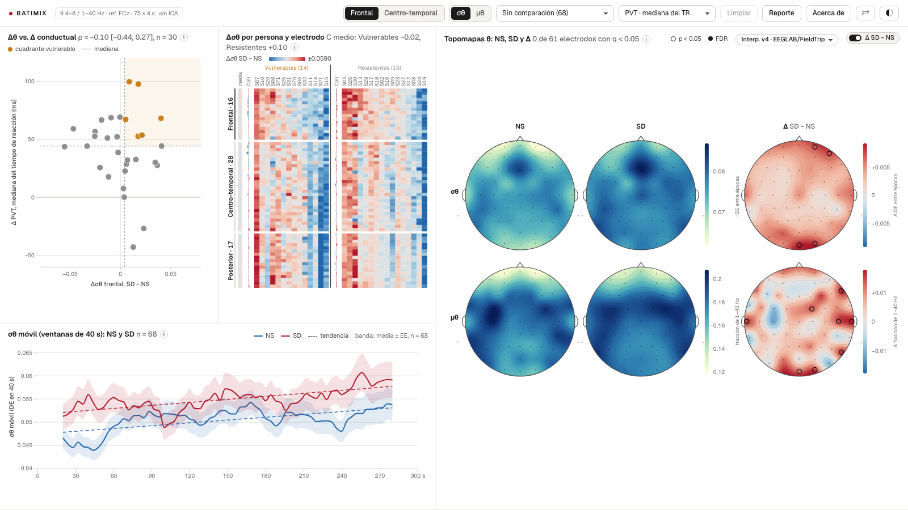

# BATIMIX: Una noche sin dormir no le pasa igual a todos (Semana 12)

Borrador refinado y respuesta a la crítica. Explorador enlazado en D3.js, **en una sola vista y con un único header**, sobre la vulnerabilidad individual a la privación de sueño en EEG de reposo (OpenNeuro ds004902, 68 personas con EEG pareado). Cuatro paneles sin espacio entre ellos: dispersión de vulnerabilidad, mapa de calor persona × electrodo, cinco minutos (σθ móvil o μθ por época) y matriz 2 × 3 de topomapas (NS, SD, Δ por σθ y μθ, o por las personas A y B elegidas en la dispersión). El multiverso de 448 análisis ya no es un panel: queda como análisis de robustez en «Acerca de», en el Reporte y en `RefinedDraftReport.md` (sección 4).

- **Aplicación:** [`app/index.html`](app/index.html), con tema oscuro (instrumento) o claro (clásico) desde el botón ◐ del header; enlaces directos con `?tema=oscuro` o `?tema=claro`
- **Despliegue (GitHub Pages):** https://andrea-coa.github.io/data-visualization-project/deliveries/week12/app/ (verificar tras el push; ver "Despliegue")
- **Página del proyecto:** [`project/index.html`](project/index.html)
- **Equipo:** Jimena Gurbillon, Andrea Coa, Paolo Medrano · DS5343 Data Visualization, UTEC 2026-2




## Contenido de la carpeta

```
deliveries/week12/
  README.md                      este archivo
  RefinedDraftReport.md          narrativa, justificación de diseño, hallazgos, limitaciones y trabajo restante
  PeerCritiqueResponse.pdf       feedback recibido y respuesta a cada sugerencia (fuente: PeerCritiqueResponse.html)
  PresentationWeek12.pptx        presentación de la semana
  paper/                         borrador inicial del paper: fuente (HTML) y PDF
  project/                       página inicial del proyecto
  app/                           código de la aplicación refinada
    index.html                   vista única: header con controles, cuatro paneles y el panel "Acerca de"
    css/styles.css               temas oscuro y claro (tokens de color y tipografía; el claro con data-theme="light"), tablero sin espacios
    js/core.js                   datos, estado, bus de eventos, grupos, selección A y B, estadística
    js/topomap.js                matriz 2 × 3 de topomapas (v4 de EEGLAB/FieldTrip; cúbica de MNE y spline esférico en el selector; isolíneas, p y FDR, filas σθ/μθ o A/B)
    js/scatter.js                dispersión de vulnerabilidad, franja de las 68 personas, lazo, A y B, tabla
    js/dynamics.js               cinco minutos: con μθ, media ± EE por época; con σθ, σθ móvil en ventanas de 40 s
    js/individuals.js            mapa de calor persona × electrodo con dos grupos definidos por la conducta y su consistencia C(e)
    js/report.js                 reporte descargable (HTML autocontenido con la vista, lectura de cada gráfico y CSV)
    js/main.js                   carga de datos, controles y arranque
    data/*.json                  datos procesados finales (y data.js para abrir con doble clic)
    tools/build_multiverse.py    genera data/multiverse.json (448 análisis, 2000 permutaciones)
    tools/build_subject_topo.py  genera data/topo_by_subject.json
    tools/build_coords.py        genera data/coords.json (2D) y data/coords3d.json (3D) desde electrodes.tsv
    tools/build_topo_stats.py    genera data/topo.json: NS, SD, Δ, t pareada, d_z e IC 95 % por electrodo (68 pareadas)
    tools/check_app.py           pruebas técnicas: estadística, efecto por electrodo, señal de referencia, consistencia, capturas
    tools/selftest.html          página que usa check_app.py para leer lo que la app calcula y muestra
    tools/check_reproduction.py  reproduce los CSV procesados desde el EEG crudo (notebook 02) y los compara con los del repo
    tools/build_data.py          regenera data/data.js desde los JSON (Python, sin Node)
    tools/build-data.js          lo mismo con Node.js
  data/                          los mismos resultados en CSV: multiverse_specs.csv, participants_deltas.csv
  assets/                        capturas de la aplicación
  research/                      informes: hechos_clave.md, literatura_verificada.md, informe_conectividad.md
```

## Cómo ejecutarlo

No requiere instalación ni build. Necesita internet para cargar D3 (cdnjs) y las fuentes (Google Fonts).

```bash
cd deliveries/week12/app
python -m http.server 8000
```

Abre `http://localhost:8000`. También funciona con doble clic sobre `app/index.html`: si el navegador bloquea `fetch` en `file://`, la página carga `data/data.js`.

Pensada para escritorio desde 1365 × 768 (todo cabe sin desplazarse). En pantallas angostas los paneles se apilan.

## Cómo reproducir los datos

1. Datos procesados de la Semana 6: ver `deliveries/week06/README.md` (descarga de ds004902 desde S3 y notebooks `01` a `03`). Producen `deliveries/week06/data/processed/*.csv`.
2. Desde `deliveries/week12/app/`:

```bash
python tools/build_subject_topo.py
```

```bash
python tools/build_coords.py
```

```bash
python tools/build_topo_stats.py
```

```bash
python tools/build_multiverse.py --perms 2000
```

```bash
python3 tools/build_data.py      # o, con Node.js: node tools/build-data.js
```

`build_multiverse.py` necesita `numpy` y `scipy`; tarda un par de minutos. Imprime un control de consistencia (Δσθ frontal recalculado frente a `merged_summary.csv`) y los estadísticos conjuntos. `build_coords.py` solo usa la biblioteca estándar: lee las posiciones 3D reales de `electrodes.tsv` (ds004902, o la muestra de `deliveries/week04/data/sample`) para el spline esférico de los topomapas y deriva de ellas la proyección 2D. `build_topo_stats.py` (requiere scipy) reemplaza al `topo.json` de la Semana 10, que no tenía generador: aquel usaba la aproximación normal para los p y calculaba Δ como diferencia de medias no pareadas (69 en NS, 70 en SD); ahora todo usa las 68 personas pareadas y la t exacta (mismos electrodos con p < 0.05; ninguno sobrevive la FDR). `participants.json` y `subject_epochs.json` vienen sin cambios de la Semana 10.

## Reproducir desde el EEG crudo

Con el dataset en `<raíz>/ds004902` (ver `deliveries/week06/README.md`; bastan los archivos de ojos abiertos, ~6 GB, que nunca se suben al repositorio):

```bash
python3 tools/check_reproduction.py
```

Corre el código del notebook `02_eeg_pipeline.ipynb` con la salida redirigida a una carpeta temporal y compara, para ojos abiertos, `eeg_theta_per_electrode.csv`, `eeg_theta_epochs_roi.csv` y las grabaciones descartadas con los de `deliveries/week06/data/processed`. Resultado del 2 de noviembre de 2026: las 8479 filas por electrodo y las 31 083 épocas por región coinciden (diferencia máxima 1.6e-7, ruido numérico entre versiones de MNE y numpy) y se descartan las mismas grabaciones. Tarda unos 15 minutos.

## Pruebas técnicas

```bash
python3 -I tools/check_app.py --out capturas_pruebas
```

Requiere Google Chrome y Python con numpy, scipy, statsmodels y mne. Compara la FDR, ρ de Spearman y su IC calculados por la app con statsmodels y scipy; t, p, d_z e IC de `topo.json` con `scipy.stats.ttest_rel`; el cálculo de θ relativa del notebook 02 con señales de valor teórico conocido (ruido blanco, senos de 6 y 10 Hz); el mismo n y los mismos conteos en títulos, «Acerca de», Reporte y tooltip; y guarda capturas a 1365 × 768 y 1600 × 900 en ambos temas para revisarlas a mano. Sale con código 1 si algo falla. No cubre reproducir la app desde el EEG crudo (requiere descargar ds004902).

## Despliegue (GitHub Pages)

1. En el repositorio: Settings, Pages, Source "Deploy from a branch", rama `main`, carpeta `/ (root)`. La raíz del repositorio tiene `.nojekyll` (sirve los archivos tal cual) e `index.html` (redirige a esta aplicación).
2. Tras el push, abrir `https://andrea-coa.github.io/data-visualization-project/deliveries/week12/app/` y comprobar que cargan los datos.

Todas las rutas son relativas. Los datos son CC0.

## Qué cambió desde la Semana 10

Tema oscuro; una sola vista sin desplazamiento ni animaciones; un único header con todos los controles; paneles sin espacio entre ellos y sin textos de instrucciones (el título de cada panel es su hallazgo); matriz 2 × 3 de topomapas con filas σθ/μθ o personas A y B; franja de las 68 personas con el conteo 39 / 29; selector de grupos (T7); PVT lapsos y DE del TR; multiverso con inferencia por permutación (análisis de robustez, sin panel propio desde el 28 de octubre). Intro, glosario, método y créditos en "Acerca de". Detalle en `RefinedDraftReport.md` y `PeerCritiqueResponse.pdf`.

## Dependencias

- D3.js 7.8.5 desde cdnjs (licencia ISC).
- Google Fonts: Geist y Geist Mono (OFL).
- Para regenerar datos y correr las pruebas: Python 3 con los paquetes de `requirements.txt` (numpy, scipy, statsmodels, pandas, mne, pymatreader) y Google Chrome para `check_app.py`. Node.js es opcional (`build-data.js`).

## Datos, créditos y uso de IA

Dataset OpenNeuro ds004902 (Xiang, Fan, Bai, Lv y Lei, 2024, *Scientific Data*), CC0. Inspiraciones: Bai et al. (2024), Cui et al. (2026), Dragicevic et al. (2019), Simonsohn, Simmons y Nelson (2020). Parte del código, del análisis y de la redacción se desarrolló con asistencia de IA (Claude, de Anthropic) y fue revisada por el equipo.

## Limitaciones conocidas

PVT pareado solo para 30 personas (poca potencia); preprocesamiento sin ICA ni re-referenciado; las pruebas por electrodo no se muestran en subgrupos; tres grabaciones de ojos abiertos (`sub-01`, `sub-28` y `sub-44`, sesión 2) están truncadas en el bucket de OpenNeuro y MNE no puede leerlas; se verificó con una descarga del 2 de noviembre de 2026, así que volver a descargar no las repara; evaluación con usuarios pendiente. Ver `RefinedDraftReport.md`, sección 6.
