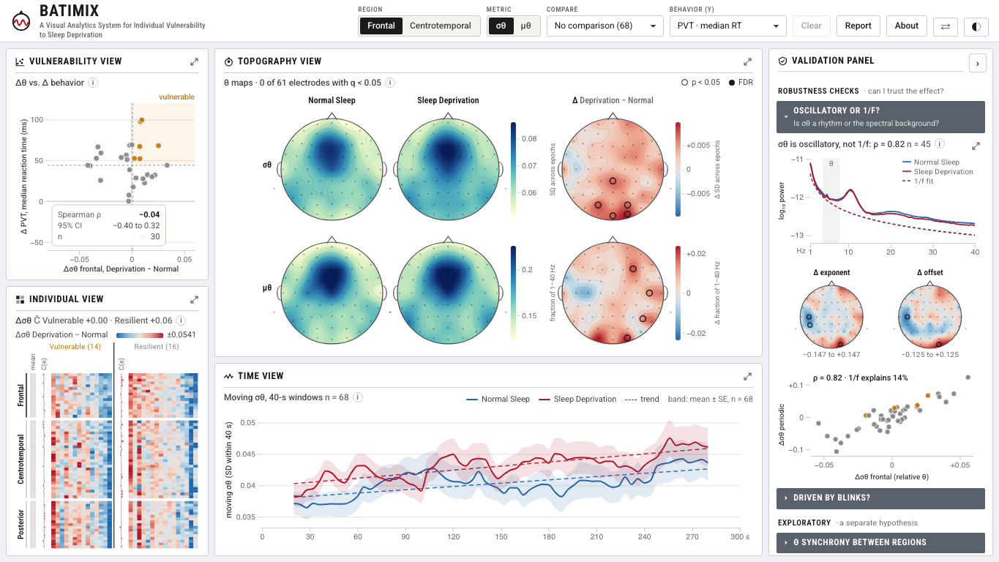
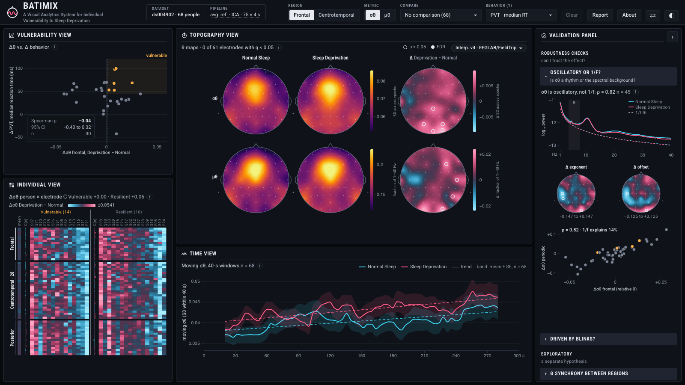

# BATIMIX: One sleepless night does not affect everyone the same way (Week 12)

Refined draft and peer-critique response. A linked D3.js explorer, **in a single view with a single header**, of individual vulnerability to sleep deprivation in resting-state EEG (OpenNeuro ds004902, 68 people with paired EEG). Three columns of boxed views, each with a short uppercase name and icon, in the style of IEEE VIS/TVCG visual analytics systems (VISTA, Unlearning Comparator): in the center, the Topography View (2 × 3 topomap matrix, the main view) with the Time View below (moving σθ or μθ per epoch); on the left, the people (Vulnerability View: scatter; Individual View: person × electrode heatmap); on the right, the collapsible Validation Panel, grouped by purpose: two robustness checks, «Oscillatory or 1/f?» (specparam) and «Driven by blinks?», and one exploratory view, «θ synchrony between regions» (wPLI). Hovering any person shows their EEG quality (epochs used, interpolated channels, blinks). Preprocessing: average reference and ICA (`tools/eeg_ica.py`), as in the sleep-deprivation EEG literature. The 896-analysis multiverse (with the preprocessing pipeline as a dimension) is kept as a robustness analysis in About, in the Report and in `RefinedDraftReport.md` (section 4).

- **Application:** [`app/index.html`](app/index.html), with a light theme (classic, default) or a dark theme (instrument) from the ◐ button in the header; direct links with `?theme=light` or `?theme=dark`
- **Deployment (GitHub Pages):** https://andrea-coa.github.io/data-visualization-project/deliveries/week12/app/ (verify after the push; see "Deployment")
- **Project page:** [`project/index.html`](project/index.html)
- **Team:** Jimena Gurbillon, Andrea Coa, Paolo Medrano · DS5343 Data Visualization, UTEC 2026-2





## Folder contents

```
deliveries/week12/
  README.md                      this file
  RefinedDraftReport.md          narrative, design rationale, findings, limitations and remaining work
  PeerCritiqueResponse.pdf       feedback received and the response to each suggestion (source: PeerCritiqueResponse.html)
  PresentationWeek12.pptx        presentation of the week
  paper/                         initial paper draft: source (HTML) and PDF
  project/                       initial project page
  app/                           code of the refined application
    index.html                   single view: header with controls, three columns and the About panel
    css/styles.css               light and dark themes (color and type tokens; dark is the base, light uses data-theme="light"), boxed views with gutters, Roboto and Roboto Condensed
    js/core.js                   data, state, event bus, groups, selection, statistics
    js/topomap.js                2 × 3 topomap matrix (EEGLAB/FieldTrip v4; MNE cubic and spherical spline in the selector; contours, p and FDR, σθ/μθ rows or two people)
    js/scatter.js                vulnerability scatter, lasso, click selection, A and B, data table
    js/dynamics.js               five minutes: with μθ, mean ± SE per epoch; with σθ, moving σθ in 40-s windows
    js/individuals.js            person × electrode heatmap with two behavior-defined groups and their consistency C(e)
    js/secondary.js              secondary views: oscillatory or aperiodic (spectrum, Δ exponent and offset, Δσθ periodic) and θ synchrony (wPLI graph and effect per pair) and eye-blink check
    js/report.js                 downloadable report (self-contained HTML with the view, how to read each chart, and CSV)
    js/main.js                   data loading, controls and start-up
    data/*.json                  final processed data (and data.js to open the page by double-click)
    tools/eeg_ica.py             shared EEG cleaning: notebook 02 + average reference + ICA (ocular and muscle) + 200 µV rejection
    tools/build_eeg_ica.py       main pipeline: generates ../data/processed_ica/*.csv from the raw EEG (same columns as Week 6)
    tools/build_participants.py  generates data/participants.json (EEG fields), data/subject_epochs.json and ../data/participants_deltas.csv
    tools/build_multiverse.py    generates data/multiverse.json and ../data/multiverse_specs.csv (896 analyses, 2000 permutations)
    tools/build_subject_topo.py  generates data/topo_by_subject.json
    tools/build_coords.py        generates data/coords.json (2D) and data/coords3d.json (3D) from electrodes.tsv
    tools/build_topo_stats.py    generates data/topo.json: NS, SD, Δ, paired t, d_z and 95% CI per electrode (68 paired people)
    tools/build_secondary.py     generates data/aperiodic.json (specparam) and data/connectivity.json (wPLI) from the raw EEG
    tools/build_quality.py       generates data/quality.json: per-person EEG quality and the blink check of σθ (raw EEG)
    tools/build_cui_variant.py   generates data/cui_variant.json: σθ with an ICA pipeline in the style of Cui et al. (raw EEG)
    tools/check_app.py           technical tests: statistics, per-electrode effects, reference signals, consistency, secondary views, screenshots
    tools/selftest.html          page used by check_app.py to read what the app computes and shows
    tools/check_reproduction.py  reproduces the processed CSVs from the raw EEG (notebook 02) and compares them with the repository
    tools/check_pvt_trials.py    diagnostic: the trial-level PVT files do not match the dataset summaries (not used by the app)
    tools/build_data.py          regenerates data/data.js from the JSON files (Python, no Node)
    tools/build-data.js          the same with Node.js
  data/                          the same results as CSV: multiverse_specs.csv, participants_deltas.csv; processed_ica/ (main EEG pipeline)
  assets/                        screenshots of the application
  research/                      research notes (in Spanish): hechos_clave.md, literatura_verificada.md, informe_conectividad.md
```

## How to run it

No installation or build step. Internet is needed to load D3 (cdnjs) and the fonts (Google Fonts).

```bash
cd deliveries/week12/app
python -m http.server 8000
```

Open `http://localhost:8000`. Double-clicking `app/index.html` also works: if the browser blocks `fetch` on `file://`, the page loads `data/data.js`.

Designed for desktop from 1365 × 768 (everything fits without scrolling). On narrow screens the panels stack, maps first.

## How to reproduce the data

With the dataset in `<root>/ds004902` (see `deliveries/week06/README.md`; the eyes-open files, ~6 GB, are enough and are never committed) and the Week 6 behavioral data (`deliveries/week06/data/processed/behavioral_deltas.csv`). From `deliveries/week12/app/`:

```bash
python3 tools/build_eeg_ica.py --procs 7
```

```bash
python3 tools/build_topo_stats.py && python3 tools/build_subject_topo.py && python3 tools/build_coords.py
```

```bash
python3 tools/build_multiverse.py --perms 2000 && python3 tools/build_participants.py
```

```bash
python3 tools/build_data.py      # or, with Node.js: node tools/build-data.js
```

`build_eeg_ica.py` is the main pipeline (`tools/eeg_ica.py`): notebook 02 (50 Hz notch, 1–40 Hz, bad channels by log-variance and interpolation), FCz re-inserted and average reference, extended Infomax ICA with 30 components, ocular components (correlation with Fp1/Fp2 an outlier, MNE `find_bads_eog`, or ICLabel eye p > 0.85) and muscle components (ICLabel p > 0.85) removed, channels still above 200 µV in more than half of the epochs interpolated, 75 4-s epochs with those above 200 µV peak-to-peak rejected. It writes `../data/processed_ica/` with the same columns as the Week 6 CSVs and caches each recording's ICA in `ds004902/derivatives/batimix-ica/` (not versioned); it takes about 20 minutes the first time. Result: 5.1 components removed per recording (2.5 ocular, 2.6 muscle), 71 of 75 epochs kept, the same 68 paired people. `build_multiverse.py` reads both pipelines (ICA and Week 6) and prints a consistency check against each `merged_summary.csv`. `build_participants.py` reproduces the Week 10 `participants.json` and `subject_epochs.json` exactly when pointed at the Week 6 data (`--proc ../../week06/data/processed`). `build_topo_stats.py` uses the 68 paired people and the exact t distribution.

## Secondary views (from the raw EEG)

```bash
python3 tools/build_secondary.py --procs 6
```

With the main pipeline (it reuses the cached ICA), it separates the periodic from the aperiodic part of the spectrum with specparam (settings of Bai et al., 2024, on this dataset) and computes theta wPLI² between 10 regions with average reference, including the mean change and 95% CI per region pair. It requires `mne-connectivity` and `fooof==1.1.0` (in `requirements.txt`) and takes about 5 minutes. If `data/aperiodic.json` or `data/connectivity.json` is missing, the app still works and the right column says so.

## Data quality and blink check (from the raw EEG)

```bash
python3 tools/build_quality.py --procs 6
```

ds004902 has no EOG channel, so ICA removes ocular components by their relation with Fp1/Fp2; this check asks whether what is left matters. Blinks are detected on Fp1/Fp2 of the raw EEG and σθ is recomputed on the ICA-cleaned data with 1-s windows, with and without the windows within 0.25 s of a blink. The script also checks that σθ recomputed with all epochs equals the app's σθ (maximum difference 4.9e-7).

## ICA pipeline in the style of Cui et al. (from the raw EEG)

```bash
python3 tools/build_cui_variant.py --procs 6
```

Reruns the eyes-open recordings with 1–30 Hz, FCz re-inserted and average reference, extended Infomax ICA (99% variance; ocular components by |r| > 0.85 with Fp1/Fp2, muscle components by ICLabel p > 0.85), 200 µV epoch rejection and relative theta over 4–30 Hz and 1–30 Hz, and compares the result with the app: group test, agreement of each person's Δσθ and Spearman with ΔPVT (including all 435 leave-two-out subsets, since Cui et al. had n = 28). Result: 2.4 components removed per recording, frontal group effect t = 2.32 (app 1.54), ρ with ΔPVT −0.06 (n = 30, never above 0.14 when leaving two out). Requires `mne-icalabel` and `onnxruntime`; about 15 minutes. The main pipeline of the app uses the same cleaning ideas but keeps the 1–40 Hz band and denominator.

## Reproducing from the raw EEG

With the dataset in `<root>/ds004902` (see `deliveries/week06/README.md`; the eyes-open files, ~6 GB, are enough and are never committed):

```bash
python3 tools/check_reproduction.py
```

It runs the code of notebook `02_eeg_pipeline.ipynb` with its output redirected to a temporary folder and compares, for eyes open, `eeg_theta_per_electrode.csv`, `eeg_theta_epochs_roi.csv` and the discarded recordings with those in `deliveries/week06/data/processed`. Result on 2 November 2026: the 8479 per-electrode rows and the 31,083 per-region epochs match (maximum difference 1.6e-7, numerical noise between MNE and numpy versions) and the same recordings are discarded. It takes about 15 minutes.

## Technical tests

```bash
python3 -I tools/check_app.py --out test_screenshots
```

Requires Google Chrome and Python with numpy, scipy, statsmodels and mne. It compares the FDR, Spearman ρ and its CI computed by the app with statsmodels and scipy; t, p, d_z and CI in `topo.json` with `scipy.stats.ttest_rel`; the relative-θ computation of notebook 02 with signals of known theoretical value (white noise, 6 and 10 Hz sines); the same n and counts in titles, About, Report and tooltip; the summary figures of the secondary views against their per-person data; and it saves screenshots at 1365 × 768 and 1600 × 900 in both themes for manual review. It exits with code 1 if anything fails. It does not cover reproducing the app from the raw EEG (see the previous section).

## Deployment (GitHub Pages)

1. In the repository: Settings, Pages, Source "Deploy from a branch", branch `main`, folder `/ (root)`. The repository root has `.nojekyll` (serves files as they are) and `index.html` (redirects to this application).
2. After the push, open `https://andrea-coa.github.io/data-visualization-project/deliveries/week12/app/` and check that the data load.

All paths are relative. The data are CC0.

## What changed since Week 10

A single view with no scrolling or animations; one header with all controls; panels with no gaps and no instruction text (each panel title is its finding); three columns with the topomap matrix as the main view and collapsible secondary views (aperiodic and θ synchrony, computed from the raw EEG); σθ/μθ rows or two selected people side by side; group selector (T7); PVT lapses and RT SD; moving σθ in the five-minute view; t, d_z and 95% CI per electrode; multiverse with permutation inference (robustness analysis, without its own panel since 28 October); English interface. Intro, glossary, method and credits in About. Details in `RefinedDraftReport.md` and `PeerCritiqueResponse.pdf`.

## Dependencies

- D3.js 7.8.5 from cdnjs (ISC license).
- Google Fonts: Geist and Geist Mono (OFL).
- To regenerate the data and run the tests: Python 3 with the packages in `requirements.txt` (numpy, scipy, statsmodels, pandas, mne, mne-connectivity, fooof, pymatreader) and Google Chrome for `check_app.py`. Node.js is optional (`build-data.js`).

## Data, credits and use of AI

Dataset OpenNeuro ds004902 (Xiang, Fan, Bai, Lv and Lei, 2024, *Scientific Data*), CC0. Inspiration: Bai et al. (2024), Cui et al. (2026), Dragicevic et al. (2019), Simonsohn, Simmons and Nelson (2020). Part of the code, the analysis and the writing was developed with AI assistance (Claude, by Anthropic) and reviewed by the team.

## Known limitations

PVT paired for only 30 people (low power); ICA components are selected automatically, without visual review; per-electrode tests are not shown for subgroups; three eyes-open recordings (`sub-01`, `sub-28` and `sub-44`, session 2) are truncated in the OpenNeuro bucket and MNE cannot read them, which was verified with a download on 2 November 2026, so downloading again does not fix them; user evaluation pending. See `RefinedDraftReport.md`, section 6.
