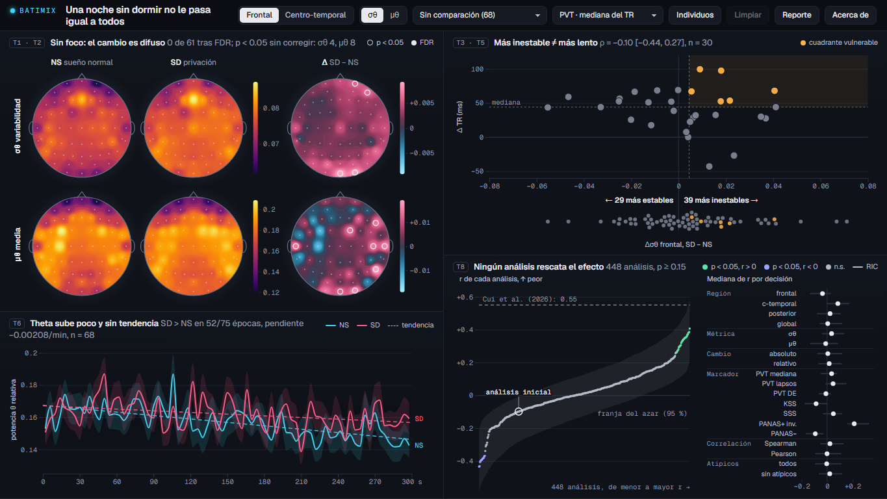

# BATIMIX: Una noche sin dormir no le pasa igual a todos (Semana 12)

Borrador refinado y respuesta a la crítica. Explorador enlazado en D3.js, **en una sola vista y con un único header**, sobre la vulnerabilidad individual a la privación de sueño en EEG de reposo (OpenNeuro ds004902, 68 personas con EEG pareado). Cuatro paneles sin espacio entre ellos: matriz 2 × 3 de topomapas (NS, SD, Δ por σθ y μθ, o por las personas A y B elegidas en la dispersión), dispersión de vulnerabilidad, cinco minutos y multiverso.

- **Aplicación:** [`app/index.html`](app/index.html) (tema oscuro) · versión alternativa clara y clásica: [`app-clasico/index.html`](app-clasico/index.html)
- **Despliegue (GitHub Pages):** https://andrea-coa.github.io/data-visualization-project/deliveries/week12/app/ (verificar tras el push; ver "Despliegue")
- **Página del proyecto:** [`project/index.html`](project/index.html)
- **Equipo:** Jimena Gurbillon, Andrea Coa, Paolo Medrano · DS5343 Data Visualization, UTEC 2026-2



## Contenido de la carpeta

```
deliveries/week12/
  README.md                      este archivo
  RefinedDraftReport.md          narrativa, justificación de diseño, hallazgos, limitaciones y trabajo restante
  PeerCritiqueResponse.pdf       feedback recibido y respuesta a cada sugerencia (fuente: PeerCritiqueResponse.html)
  PresentationWeek12.pptx        presentación de la semana
  paper/                         borrador inicial del paper: fuente (HTML) y PDF
  project/                       página inicial del proyecto
  app-clasico/                   versión alternativa clara y clásica: reutiliza el código y los datos de app/ con su propia hoja de estilo
    index.html                   misma estructura; carga ../app/js y ../app/data
    css/clasico.css              tema claro: Source Serif 4, Source Sans 3, Source Code Pro y paletas de ColorBrewer
  app/                           código de la aplicación refinada
    index.html                   vista única: header con controles, cuatro paneles y el panel "Acerca de"
    css/styles.css               tema oscuro (tokens de color y tipografía), tablero sin espacios
    js/core.js                   datos, estado, bus de eventos, grupos, selección A y B, estadística
    js/topomap.js                matriz 2 × 3 de topomapas (IDW, isolíneas, p y FDR, filas σθ/μθ o A/B)
    js/scatter.js                dispersión de vulnerabilidad, franja de las 68 personas, lazo, A y B, tabla
    js/dynamics.js               cinco minutos: media ± EE por época
    js/multiverse.js             curva de especificación, franja del azar y mediana de r por decisión
    js/report.js                 reporte descargable (HTML autocontenido con la vista, lectura de cada gráfico y CSV)
    js/main.js                   carga de datos, controles y arranque
    data/*.json                  datos procesados finales (y data.js para abrir con doble clic)
    tools/build_multiverse.py    genera data/multiverse.json (448 análisis, 2000 permutaciones)
    tools/build_subject_topo.py  genera data/topo_by_subject.json
    tools/build-data.js          regenera data/data.js desde los JSON
  data/                          los mismos resultados en CSV: multiverse_specs.csv, participants_deltas.csv
  assets/                        capturas de la aplicación
  research/                      informes: hechos_clave.md, literatura_verificada.md, informe_conectividad.md
```

## Cómo ejecutarlo

No requiere instalación ni build. Necesita internet para cargar D3 (cdnjs) y las fuentes (Google Fonts).

```bash
cd deliveries/week12/app
python -m http.server 8000
```

Abre `http://localhost:8000`. También funciona con doble clic sobre `app/index.html`: si el navegador bloquea `fetch` en `file://`, la página carga `data/data.js`.

Pensada para escritorio desde 1365 × 768 (todo cabe sin desplazarse). En pantallas angostas los paneles se apilan.

## Cómo reproducir los datos

1. Datos procesados de la Semana 6: ver `deliveries/week06/README.md` (descarga de ds004902 desde S3 y notebooks `01` a `03`). Producen `deliveries/week06/data/processed/*.csv`.
2. Desde `deliveries/week12/app/`:

```bash
python tools/build_subject_topo.py
```

```bash
python tools/build_multiverse.py --perms 2000
```

```bash
node tools/build-data.js
```

`build_multiverse.py` necesita `numpy` y `scipy`; tarda un par de minutos. Imprime un control de consistencia (Δσθ frontal recalculado frente a `merged_summary.csv`) y los estadísticos conjuntos. `participants.json`, `topo.json`, `coords.json` y `subject_epochs.json` vienen sin cambios de la Semana 10.

## Despliegue (GitHub Pages)

1. En el repositorio: Settings, Pages, Source "Deploy from a branch", rama `main`, carpeta `/ (root)`.
2. Tras el push, abrir `https://andrea-coa.github.io/data-visualization-project/deliveries/week12/app/` y comprobar que cargan los datos.

Todas las rutas son relativas. Los datos son CC0.

## Qué cambió desde la Semana 10

Tema oscuro; una sola vista sin desplazamiento ni animaciones; un único header con todos los controles; paneles sin espacio entre ellos y sin textos de instrucciones (el título de cada panel es su hallazgo); matriz 2 × 3 de topomapas con filas σθ/μθ o personas A y B; franja de las 68 personas con el conteo 39 / 29; selector de grupos (T7); PVT lapsos y DE del TR; multiverso con inferencia por permutación. Intro, glosario, método y créditos en "Acerca de". Detalle en `RefinedDraftReport.md` y `PeerCritiqueResponse.pdf`.

## Dependencias

- D3.js 7.8.5 desde cdnjs (licencia ISC).
- Google Fonts: Geist y Geist Mono (OFL).
- Para regenerar datos: Python 3 con numpy y scipy; Node.js para `build-data.js`.

## Datos, créditos y uso de IA

Dataset OpenNeuro ds004902 (Xiang, Fan, Bai, Lv y Lei, 2024, *Scientific Data*), CC0. Inspiraciones: Bai et al. (2024), Cui et al. (2026), Dragicevic et al. (2019), Simonsohn, Simmons y Nelson (2020). Parte del código, del análisis y de la redacción se desarrolló con asistencia de IA (Claude, de Anthropic) y fue revisada por el equipo.

## Limitaciones conocidas

PVT pareado solo para 30 personas (poca potencia); preprocesamiento sin ICA ni re-referenciado; las pruebas por electrodo no se muestran en subgrupos; el archivo de ojos abiertos de `sub-01` cambió en la versión 1.0.8 del dataset y debe volver a descargarse; evaluación con usuarios pendiente. Ver `RefinedDraftReport.md`, sección 6.
