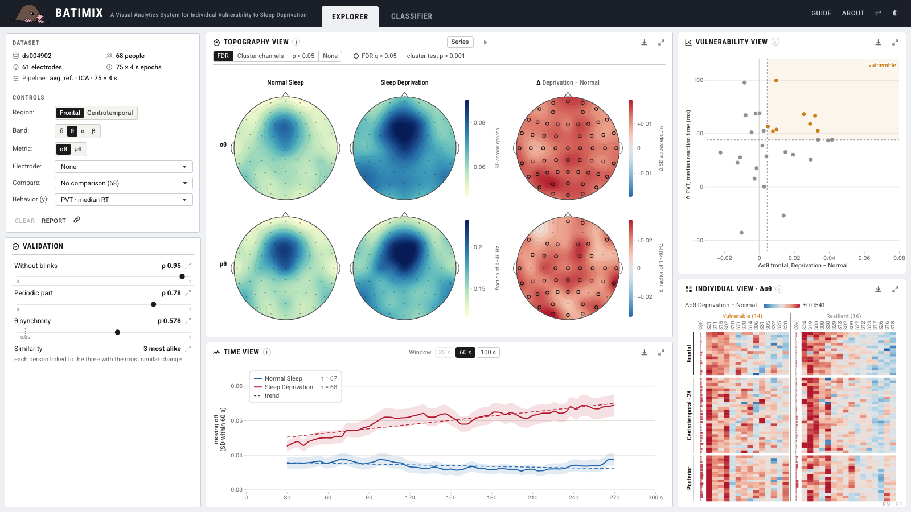

# BATIMIX: One sleepless night does not affect everyone the same way

**Refined Draft Report, Week 12** · DS5343 Data Visualization, UTEC 2026-2
**Team:** Jimena Gurbillon, Andrea Coa, Paolo Medrano
**Date:** 28 October 2026 (updated 3 and 15 November 2026)
**Application:** `deliveries/week12/app/` · planned deployment at https://andrea-coa.github.io/data-visualization-project/deliveries/week12/app/ (verify after the push)

> **Correction, 15 November 2026.** In ds004902 the session folder gives the condition (`ses-1` is always normal sleep, `ses-2` always deprivation; the visit order is only in `SessionOrder`). Our pipeline took `ses-1` as the first condition of `SessionOrder`, so for the 28 people who were deprived first, normal sleep and deprivation were swapped in the EEG. It is now fixed and every number in this report was recomputed. The main conclusions changed: deprivation does raise theta variability across the whole scalp. Evidence and before/after figures: `research/correccion_sesiones.md`.

## 1. Narrative

**Problem.** After the same sleepless night, some people deteriorate a lot and others barely at all. The group average dilutes that difference (Van Dongen et al., 2004). Cui et al. (2026) proposed an individual marker: how much the variability of theta power across 4-s epochs (σθ) increases in resting EEG, and reported that it is associated with slowing on the psychomotor vigilance task (PVT; ρ = 0.544 frontal, n = 28).

**Audience and decision.** Sleep physiology researchers doing exploratory screening on public data. The tool helps decide which channels, regions and covariates deserve a formal test. It is neither diagnostic nor predictive.

**Data.** OpenNeuro ds004902 (Xiang et al., 2024, CC0): 71 people, normal sleep (NS) versus 24–30 h without sleep (SD), 61-channel eyes-open EEG. 68 have EEG in both conditions; of these, PVT 30, KSS 32, SSS 33 and PANAS 65.

**Analytic sequence.** Each view answers one question. The answers are computed live from the data; on screen they appear in the view's ⓘ note or in its legend box, and the exported Report keeps them as figure titles (with ρ, CI and n):

| Question | Answer (real data) | View |
|---|---|---|
| Does everyone change the same way? | No, but most rise: 50 people become more unstable and 18 more stable; the mean rises +0.0129 (SD across people 0.018; t = 5.88, d_z = 0.71) | Vulnerability and Individual views |
| Where does it change on the head? | Everywhere: σθ survives FDR at 61 of 61 electrodes (d_z 0.30 to 0.77), μθ at 45 of 61 | Topography View, Δ column |
| When, within the five minutes? | Throughout: moving σθ in SD above NS in every window (frontal; 61 of 61 with 60 s, 66 of 66 with 40 s, 51 of 51 with 100 s). In the Series of 5 × 60 s, 445 of 610 electrode-blocks survive FDR across blocks (68 people) | Time View; Topography View, Window and Series |
| Is more unstable slower? | Weakly, and only centrotemporal: ρ = +0.37 [+0.01, +0.64], n = 30; frontal +0.16 [−0.21, +0.49]. Same direction as Cui et al. (0.54 to 0.56), weaker | Vulnerability View (figure in the Report) |
| Is the effect oscillatory or 1/f? | Mostly oscillatory: the change in σθ tracks the change in periodic theta (ρ = 0.78 frontal, 0.86 centrotemporal); the aperiodic offset also rises (d_z = 0.48) | Validation Panel, «Oscillatory & aperiodic components» |
| Does the change predict who deteriorates, however it is analyzed? | Across 896 alternative analyses (two preprocessing pipelines), no joint statistic exceeds chance (p ≥ 0.34); PVT median RT is the most consistent marker | About, «Robustness» (section 4) |

**Preliminary conclusion.** Without sleep, theta becomes more unstable and higher across the whole scalp, in most but not all people (about one in four goes the other way). How much it rises tracks slower reaction times only weakly (centrotemporal ρ = +0.37 with n = 30), in the same direction as Cui et al. but not robustly across analytic choices. It is a group marker of sleep loss more than an individual marker of who deteriorates.

## 2. What changed since Week 10

| Before (Week 10) | Now (Week 12) | Why |
|---|---|---|
| Light dashboard of three separate cards, with a commented scrolling story | Single view of boxed views with narrow gutters that fill the screen (1365 × 768 without scrolling); light theme by default, dark as an option | Instructor feedback (no white space) and team decision (one view, no scrollytelling) |
| Controls spread over several bars and inside each card | One header with the title and all controls | Visual noise from controls |
| Help text ("drag to…", "hover…") and role labels | No instruction text or subtitles over the charts: each view has a short name with an ⓘ icon next to it (reading, method and figures), and legends sit in boxes inside the charts that can be dragged or collapsed to an icon; intro, glossary and method in About | Visual noise and more room for the charts; team request |
| Transition animations and a Play button | No animations: every state change is immediate | No motion graphics |
| Two marks on every Δ map at once: rings at uncorrected p < 0.05 and dots for FDR | One layer at a time, chosen in the legend: **FDR** by default, drawn as thin rings as in Cui et al. (2026, the re-examined study, same dataset); cluster channels (descriptive), uncorrected p or none. The cluster-based permutation test is reported as a global result in the legend and the ⓘ («cluster test p < 0.001»; over electrodes × blocks in the Series) | Uncorrected marks mix real changes with chance (about 3 of 61 at p < 0.05) and two layers added noise. FDR supports per-electrode statements; the cluster test (Maris and Oostenveld, 2007) shows that the maps differ but does not establish where (Sassenhagen and Draschkow, 2019; FieldTrip FAQ), so it is reported as a global test. Implemented from scratch and checked against MNE |
| ▶ playback of the maps with a fixed 40-s window (added in Week 12) as the only way to see time in the topomaps | Static by default. Click a moment in the Time View to show a window of the chosen length (Window: 32, 60 or 100 s; at least 60 s for σθ) on the maps; **Series** shows Δ maps in consecutive non-overlapping blocks aligned with the Time View, with FDR across all blocks × electrodes; ▶ stays as an optional presentation mode. A label at the foot of the maps always says what they show | For analysis, small multiples are more accurate than animation (Robertson et al., 2008; Brehmer et al., 2020); wakefulness drifts within minutes of rest (Tagliazucchi and Laufs, 2014); per-window tests were not corrected across 66 overlapping windows; short sliding windows yield spurious fluctuations (Leonardi and Van De Ville, 2015) |
| Inverse-distance (IDW) maps on hand-approximated 2D coordinates | Biharmonic v4 interpolation, as in EEGLAB `topoplot` and FieldTrip `ft_topoplotER`, on the real positions in `electrodes.tsv` in azimuthal equidistant projection; since 2 November it is the only method in the app (the selector that also showed MNE's Clough-Tocher cubic and the spherical spline, Perrin et al., 1989, was removed). All three implementations reproduce the originals (EEGLAB and FieldTrip in MATLAB R2022a, MNE 1.8) with an error below 1e-9 of the range. With all 68 people, the v4 map correlates r ≥ 0.985 with MNE's cubic and r ≥ 0.93 with the spherical spline in all six maps | IDW is not a standard for EEG topomaps; use the community's reference method and show that the pattern does not depend on it |
| No indication of pipeline or units; electrode tooltip with p and q | Fixed chip in the header (now θ 4–8 / 1–40 Hz · avg. ref. · ICA · 75 × 4 s, linked to the method); units on the color bars; the Time View legend gives each series' n and its ⓘ note explains the band (± SE); tooltip with t(67), d_z and 95% CI of Δ. The Δ map of the 68 is now paired and p uses the exact t distribution (formerly a normal approximation); same conclusions | The first questions of a neurophysiologist: which pipeline, which units, what effect size |
| Five minutes always showed the mean (μθ), even with σθ selected | Follows the σθ/μθ button: with σθ it shows moving σθ (SD of regional θ in windows of the chosen length, 60 s by default, sliding by one epoch). Exploratory and labeled: its scale is smaller than the scatter σθ because it starts from the region-averaged series | Q6 for the central metric: the state-instability hypothesis (Doran, Van Dongen and Dinges, 2001) predicts more moment-to-moment variability without sleep; Cui et al. (2026) summarize it as a single number without temporal order; 40 s is where resting spectral power reaches its reliability (Gudmundsson et al., 2007) |
| Two columns with maps and views of the same size; no secondary views | Three columns with the topomap as the main view and a collapsible Validation Panel: «Oscillatory & aperiodic components» (specparam: spectrum with a click-to-zoom θ band, Δ exponent and offset maps, Δσθ against periodic Δσθ with ρ, R² and n) and «θ synchrony between regions» (wPLI graph and effect per pair), computed from the raw EEG with `tools/build_secondary.py` and linked to the selection | Visual hierarchy (instructor critique) and the first objection a neurophysiologist would raise: is it oscillation or 1/f background? |
| No automatic verification of the numbers | `tools/check_app.py`: 16 tests (FDR and ρ against statsmodels and scipy, t and d_z against scipy, reference signals with MNE, consistency of n across titles, About, Report and tooltip, secondary views, screenshots) and `tools/check_reproduction.py` (the processed data reproduce from the raw EEG) | A miscalculated number invalidates the tool for an expert |
| One topomap with σ/μ and NS/SD/Δ toggles | 2 × 3 topomap matrix: NS, SD and Δ columns; σθ and μθ rows, or one row per person when exactly two people are selected | Compare conditions, metrics and people without toggling (T1, T2, T4) |
| Selection with the lasso only; fixed ρ for the 68 | Lasso, click selection from 1 to n people, and **Compare two groups** (women vs men, session order, PSQI, vulnerable vs rest), with one color per group in every view (ρ per group in the Report). Selection and comparison combine: the points keep their group colors and the Topography and Time views follow the selection | Task T7: moderators side by side, not filtered one at a time |
| Views that only displayed | All linked: an electrode (from the **Electrode** selector in the header, a map or a heatmap row) or a time window redefines the scatter x-axis; clicking points or heatmap columns builds the selection; two selected people are compared side by side | "Everything interactive": each view is also a control |
| No per-person view | Fixed person × electrode heatmap: two groups defined by behavior only (deteriorate vs resist, or the Compare groups) and their consistency C(e); selected people are outlined without reordering | Tasks T3 and T4 without averages: do those who deteriorate share a signature? |
| No way to take the view away | **Report** button: self-contained HTML with the current view, how to read each chart, the people table and its CSV | Let the researcher document and share what they found |
| Long titles | Short view names (the Individual View adds the metric, e.g. «Δσθ»); no headlines over the charts: figures go in the ⓘ notes, the legend boxes and the Report | Each view conveys its message in a few words and the charts get the space |
| Markers: median PVT, KSS, SSS, PANAS | Also PVT lapses and RT SD | Basner and Dinges (2011) |
| No response to the non-replication | Multiverse (448 analyses, now 896 with the preprocessing pipeline as a dimension) with permutation inference. It had its own panel in the 28 October delivery; later, to reduce the number of charts, it moved to About and the Report as a robustness analysis | Methodological contribution (section 4) |
| No per-person data quality; no artifact check | Tooltip with each person's EEG quality (epochs used, interpolated channels, blinks per minute) and a secondary «Blink effects on θ variability» view (`tools/build_quality.py`) | There is no EOG channel and ICA removes ocular components by rule, so the first suspicion about frontal theta is residual blinks |
| Preprocessing without ICA, FCz reference (the first question of a reviewer; every recent multi-channel sleep-deprivation study uses ICA) | Main pipeline with average reference and ICA (`tools/eeg_ica.py`); all app data regenerated; the Week 6 pipeline kept as a multiverse dimension; Cui-style rerun (`tools/build_cui_variant.py`) | Snipes et al. (2022), Lian et al. (2023), Ma et al. (2023), Liu, Xie and Ma (2024), Cui et al. (2026); see References |
| Spanish interface | English interface | The tool and its figures will be part of an English paper |

## 3. Design rationale

**Layout.** Three columns, following the team's sketch and the most common pattern in IEEE VIS systems (Chen et al.: large views in the center, narrow side panels). Since 2 November each view is a box with a short uppercase name and an icon (Vulnerability, Individual, Topography and Time views; Validation Panel), with an ⓘ icon next to the name for the reading and the figures and no subtitle over the chart; controls carry a label above them (Region, Metric, Electrode, Compare, Behavior), the header has the system name, a one-line description and a dataset summary, and conditions are written out as Normal Sleep and Sleep Deprivation, following VISTA and Unlearning Comparator. Center: the topomap matrix, the main view, with the five-minute series below, wide enough for its 75 epochs. Since 17 November, following VISTA and model-analysis tools such as JaMoNA: the controls moved from a top bar to a box in the left column under the name (so no button falls off narrow screens and the maps gain height); the people moved to the right, with more room; and the secondary views became a **Validation** table under the controls, one row per check with its key figure, whose charts open in floating, non-modal windows that can be moved, resized and opened side by side, each sized for its chart. A thin dark top bar, as in Unlearning Comparator, holds the name, the two tabs (**Explorer** and **Classifier**, browser-like, the active one opening onto the page) and the global actions; below it, both tabs share one sidebar that never moves (Dataset, the tab's Controls, global actions and a Validation summary in which every check has its figure and a small chart); only the central and right areas change, so switching tabs reloads nothing and does not feel like leaving the page. The ⇄ button swaps the side columns; the center does not move. On narrow screens the panels stack, controls first, then the maps.

**Tasks and views** (typology of Brehmer and Munzner, 2013). Since 15 November every task can also be done for delta, alpha or beta with the **Band** selector (δ θ α β) in the header; theta σ remains the confirmatory hypothesis and the other bands are exploratory (section 5b):

| Task | Question | View | How it answers |
|---|---|---|---|
| T1 Locate | Where does theta change? (Q1) | Matrix, Δ column | Interpolated map (EEGLAB/FieldTrip v4) with ring (p < 0.05) and fill (FDR) |
| T2 Compare metrics | Variability or mean? (Q2) | Matrix, σθ and μθ rows | Both metrics in view, one above the other |
| T3 Identify | Who is vulnerable? (Q3) | Scatter; heatmap | Amber quadrant labeled «vulnerable» (above both medians), lasso and click selection; one column per person |
| T4 Compare | Do they share a spatial signature? (Q4) | Matrix by group; two selected people; heatmap | Mean of the active group; two people with shared scales; C(e) per group |
| T5 Correlate | Does it converge with each marker? (Q5) | Scatter, Y-axis | The point cloud against the marker medians; Spearman ρ with 95% CI and n, recomputed for the selection or per group, in the Report figure |
| T6 Describe trend | Does it change within the recording? (Q6) | Time View; Topography View (Window, Series) | With μθ, mean ± SE per epoch; with σθ, moving σθ in windows of the chosen length (60 s by default); n per series in the legend. Clicking it shows that window on the maps (exploratory); Series places Δ maps of each block above its stretch of the curve, with FDR across blocks × electrodes, and separates fast within-block variability from the slow drift between blocks |
| T7 Compare groups | Do sex, PSQI or session order matter? (Q7) | Compare selector | Two groups with two colors in every view: map rows, heatmap blocks, Δ per epoch with each group's n; ρ per group in the Report |
| T8 Check robustness | Does it depend on analytic decisions? Is it oscillatory? | About, «Robustness»; secondary views | Joint multiverse statistics with their permutation p; periodic vs aperiodic separation; θ synchrony with effects and CIs per pair |

**Encoding and color.** Light theme by default with ColorBrewer palettes; an optional dark "instrument" theme. When the two map rows share a scale (two people or two groups), each color column has a single long bar instead of one per row. NS = blue, SD = red. NS and SD share a sequential scale per row so that comparing columns means comparing values; with two people both rows share the scale. Δ uses a diverging scale with a neutral zero. Amber marks the vulnerable quadrant. Selection is marked with a ring (scatter) or an outline (heatmap) without changing the point colors, which keep their meaning. Direct labels («vulnerable» inside its quadrant, row and column names) and legends inside the charts, in boxes placed in the least crowded corner, instead of distant legends.

**Typography.** Roboto for text and figures (tabular digits) and Roboto Condensed for view names, column headers and control labels. At least 9–10 px in charts; only dense heatmap labels go smaller (minimum 7 px).

**Interaction.** Lasso, click to add or remove people (1 to n), Shift + click for people A and B, Esc and Clear, group selector (combinable with a selection), global region, metric and electrode; the ⤢ button of each view opens it almost full screen (Esc restores it); the ⇄ button swaps the side columns; legend boxes can be dragged (or moved with the arrow keys) and collapsed to an icon with a click; a click on the θ band of the spectrum zooms it to 4–8 Hz and another restores 1–40 Hz. Choosing an electrode (Electrode selector, a map or a heatmap row) also switches the Time View from the region to that electrode's own series, with its larger scale, so a local effect can be checked over the five minutes. Immediate response, no decorative animation, visible focus states.

**Accessibility.** AA contrast, visible focus, group selector as an alternative to the lasso, data table in About.

**Bands.** Choosing a band reloads the data of that band (`data/bands/<band>/`) and relabels every text on screen (σθ → σα, theta → alpha, 4–8 Hz → 8–13 Hz) without editing the views one by one; the views computed only for theta (blink check, synchrony, the periodic scatter of the oscillatory view, the multiverse and the findings in About) keep theta and show a «θ only» badge. The spectrum of the oscillatory view marks the chosen band. The Time View keeps a fixed y-axis that only changes with the band, the metric, the region or electrode, the window length and whether a comparison is shown, so selecting, comparing or playing never rescales it.

## 4. Contribution: a multiverse of 896 analyses

A single correlation is one of many possible decisions. To respond honestly to the non-replication of Cui et al., we computed **896 specifications**: 2 preprocessing pipelines (average reference with ICA, the main one, or FCz reference without ICA, Week 6) × 4 regions (frontal, centrotemporal, posterior, global) × 2 metrics (σθ, μθ) × 2 forms of change (absolute, relative) × 7 behavioral markers × 2 correlations (Spearman, Pearson) × 2 outlier rules (all, exclude |z| > 2.5). All are oriented toward deterioration, so the hypothesis predicts r > 0.

Joint inference follows Simonsohn, Simmons and Nelson (2020), adapted to observational data without covariates: the behavioral rows are permuted among the 68 participants (2000 times), the whole multiverse is recomputed, and three statistics are compared with their null distribution. The threshold of each statistic is the 95th percentile of its permuted distribution. In the 28 October delivery it had an explorable panel (Dragicevic et al., 2019); to reduce the number of charts, the team removed it from the board and kept it as a robustness analysis in About and in the Report, with all results in `data/multiverse_specs.csv`.

| Test | Median r | Significant with r > 0 | Stouffer Z |
|---|---|---|---|
| Main, σθ only (448) | +0.030 (p = 0.34) | 3; chance reaches 58 (p = 0.54) | +2.02 (p = 0.40) |
| Full multiverse (896) | +0.027 (p = 0.34) | 4; chance reaches 102 (p = 0.72) | +2.95 (p = 0.40) |

Only 4 of the 896 analyses are significant in the predicted direction (2 with PVT median RT, 1 with PANAS− and 1 with PVT lapses). The most consistent marker is PVT median RT: median r = +0.21 over its 128 analyses (−0.03 to +0.39), but it does not exceed chance jointly: it remains a hypothesis. Before the session correction, the only consistent signal was PANAS+; it no longer is (median r = −0.08). The recomputed frontal Δσθ matches `merged_summary.csv` of each pipeline (maximum difference 4e−17; the Week 6 pipeline is read with the corrected session labels, see `tools/build_multiverse.py`).

**Why it might not replicate** (`research/literatura_verificada.md`): Cui et al. used average reference, ICA, a 1–30 Hz filter, a 4–30 Hz denominator, epoch rejection and reaction-time cleaning, with n = 28; our Week 6 pipeline used FCz reference, no ICA, a 1–40 Hz denominator and n = 30; the main pipeline now uses average reference and ICA (finding 10). With n = 30, the probability of detecting ρ = 0.3 is close to 0.35. **We tested this directly** (`tools/build_cui_variant.py`): rerunning the raw EEG with their pipeline (1–30 Hz, average reference, extended Infomax ICA at 99% variance removing ocular components by |r| > 0.85 with Fp1/Fp2 and muscle components by ICLabel p > 0.85, 200 µV epoch rejection, 4–30 Hz denominator) removes 1.9 and 2.6 components per recording (NS and SD; Cui: 2.6 to 3.1) and keeps 69 of 75 epochs. ΔσΘ then tracks ΔPVT centrotemporally (ρ = +0.33, p = 0.08, n = 30; all 435 ways of leaving two people out give +0.19 to +0.47) but not frontally (ρ = −0.04; −0.25 to +0.11), against 0.544 and 0.558 in Cui et al. (n = 28). The centrotemporal result partly replicates; the frontal one does not. The PVT variable (Cui likely recomputed median RT from trials) and sampling remain possible reasons.

## 5. Preliminary findings

All figures after the session correction of 15 November 2026 (`research/correccion_sesiones.md`).

1. **Most people become more unstable after deprivation, but not all.** Frontal σθ rises in 50 people and falls in 18; the mean rises +0.0129 (SD across people 0.018; t = 5.88, p < 0.001, d_z = 0.71). Centrotemporal: 53 and 15 (d_z = 0.76). μθ also rises (frontal d_z = 0.36, centrotemporal 0.51).
2. **The change is widespread.** σθ survives FDR at all 61 electrodes (d_z 0.30 to 0.77) and μθ at 45 of 61: no single focus, the whole scalp.
3. **It holds throughout the five minutes.** Moving σθ is higher after deprivation in every window (61 of 61 with 60 s), and in the Series of 5 × 60 s, 445 of 610 electrode-blocks survive FDR across blocks.
4. **The link with vigilance is weak and regional.** Δσθ centrotemporal vs ΔPVT median RT: ρ = +0.37 [+0.01, +0.64], n = 30 (p = 0.047, uncorrected); frontal +0.16 [−0.21, +0.49]. Not with lapses (frontal −0.17, centrotemporal 0.00).
5. **Across the multiverse no joint statistic exceeds chance** (section 4). PVT median RT is the most consistent marker (median r = +0.21 over 128 analyses), which is the direction Cui et al. reported.
6. **Person by person:** with the groups of the Individual View defined by PVT (14 who deteriorate more than the median, 16 who resist), both groups rise, and those who deteriorate rise more consistently (mean consistency C = +0.50 vs +0.29 in σθ; +0.45 vs +0.31 in μθ). With PANAS+ it is the other way (C = +0.35 for those who lose positive affect vs +0.49), so the earlier «mood» signal does not hold. The similarity graph has not been re-analyzed after the correction.
7. **σθ is mostly oscillatory.** Each person's change in σθ tracks the change in their periodic theta (ρ = 0.78 frontal, n = 46; 0.86 centrotemporal, n = 52: people with at least 50 well-fitted epochs per session). The change in the epoch-to-epoch variability of the aperiodic exponent explains only R² = 0.06 (frontal) and 0.11 (centrotemporal) of Δσθ. Periodic theta rises after deprivation (d_z = 0.56), and so do the aperiodic offset (d_z = 0.48, p < 0.001) and, less, the exponent (d_z = 0.25, p = 0.042), as Bai et al. (2024) report on this dataset; the earlier statement that the offset change disappears with ICA came from the session mix-up. A theta peak appears at 40% of electrodes after normal sleep and 54% after deprivation, as Monchy et al. ask to verify before interpreting theta.
8. **Blinks do not drive σθ.** Blinks detected on Fp1/Fp2 of the raw EEG rise somewhat with deprivation (median 17.1 → 22.8 per minute in the people with both nights; t = 1.36, p = 0.18). Removing the 1-s windows within 0.25 s of a blink leaves each person's Δσθ almost unchanged (ρ = 0.95 frontal, 0.93 centrotemporal, n = 47), the group increase survives (t = 4.57 frontal), within recordings epochs with more blinks do not have more theta (r = −0.05), and the change in blink rate is unrelated to Δσθ (ρ = 0.15, p = 0.23).
9. **Theta synchrony between regions (exploratory).** With average reference and wPLI², it decreases in 30 of 45 region pairs after deprivation, but the global change is small (d_z = −0.08, permutation p = 0.58) and no pair survives FDR.
10. **The result does not depend on the preprocessing pipeline.** ICA removes 5.1 components per recording (2.5 ocular, 2.6 muscle) and 71 of 75 epochs are kept. The Week 6 pipeline without ICA, read with the corrected session labels, also shows the increase (frontal t = 3.44, centrotemporal t = 5.72), and each person's Δσθ agrees with the main pipeline (ρ = 0.64 frontal, 0.79 centrotemporal). Copying Cui et al. exactly gives frontal t = 4.53 and centrotemporal t = 5.97 (section 4).
11. **It is not a visit effect.** In a two-period crossover analysis by session order, the deprivation effect adjusted for visit, c, is +0.0128 in frontal σθ (Welch t = 5.40, p = 2.2e-6) and survives FDR at 61 of 61 electrodes; the visit effect (2nd − 1st visit) survives at none, in any band. Behavior agrees: KSS c = +2.25, PVT median RT c = +42.7 ms, both with π not significant (`research/analisis_cruzado.md`).

## 5b. Other bands (exploratory)

Relative power of each band over 1–40 Hz, computed in the same spectral pass as theta (`tools/build_eeg_ica.py`; band edges in `tools/eeg_ica.BANDS`; the five parts, with the 30–40 Hz rest, sum to 1). Paired t-test per electrode with FDR inside each band × metric (61 tests), 68 people. Theta σ is the confirmatory hypothesis; everything else here is exploratory and not corrected across bands.

| Band | σ: electrodes p < 0.05 / q < 0.05 (d_z range) | μ: p < 0.05 / q < 0.05 | Frontal σ: up / down, d_z | ρ(frontal Δσ, ΔPVT), n = 30 |
|---|---|---|---|---|
| Delta, 1–4 Hz | 49 / 49 (+0.14 to +0.50) | 1 / 0 | 48 / 20, +0.43 | +0.17 |
| **Theta, 4–8 Hz** | **61 / 61 (+0.30 to +0.77)** | 51 / 45 | 50 / 18, +0.71 | +0.16 (centrotemporal +0.37) |
| Alpha, 8–13 Hz | 6 / 0 (−0.05 to +0.33) | 6 / 0 | 42 / 26, +0.14 | −0.15 |
| Beta, 13–30 Hz | 25 / 7 (+0.01 to +0.47) | 16 / 2 | 45 / 23, +0.33 | +0.25 |

Reading: after deprivation the epoch-to-epoch variability rises most in theta, then in delta and less in beta; alpha does not change. Mean power rises only in theta. No band links clearly with the PVT (no ρ reaches p < 0.05 except centrotemporal theta). Caveats in section 6.

**Band as a multiverse dimension** (`tools/build_multiverse_bands.py`, 2240 analyses, the same 2000 permutations of the behavioral rows for every band; theta keeps both pipelines, the other bands only the main one because the Week 6 pipeline computed theta only):

| Band | Analyses | Median r (p) | Significant with r > 0 (chance up to) | Stouffer Z (p) |
|---|---|---|---|---|
| Delta | 448 | −0.044 (p = 0.77) | 0 (57) | −1.52 (p = 0.60) |
| Theta | 896 | +0.027 (p = 0.33) | 4 (103) | +2.95 (p = 0.39) |
| Alpha | 448 | +0.005 (p = 0.46) | 3 (56) | −3.34 (p = 0.67) |
| Beta | 448 | +0.062 (p = 0.13) | 8 (46) | +3.94 (p = 0.28) |
| All bands | 2240 | +0.017 (p = 0.28) | 15 (157) | +1.45 (p = 0.42) |

No band exceeds chance jointly, with σ only either (theta σ median r +0.030, p = 0.33; beta σ +0.073, p = 0.16). By marker, PVT median RT has the most positive median r in theta (+0.21) and delta (+0.23), and a negative one in alpha (−0.21): the weak vigilance link is specific to slow bands. The theta p values differ slightly from section 4 because the permutations are drawn again; its 896 r are identical (checked). The all-band joint test mixes non-equivalent measures and is descriptive only.

**Oscillatory or aperiodic, by band** (specparam, same settings as finding 7; frontal, n = 46): the change in epoch-to-epoch variability tracks its periodic part in theta (ρ = 0.78) and alpha (0.86), less in beta (0.44) and barely in delta (0.30), where the variability of the aperiodic exponent explains most of it (R² = 0.68 vs 0.06 in theta). So the delta increase in σ is mostly a broadband (1/f) change, not a delta rhythm; the theta increase is oscillatory. Periodic power itself rises only in theta (d_z = 0.56, p = 1.7e-5, 48 of 61 electrodes with q < 0.05; delta d_z = −0.21, p = 0.09; alpha −0.04; beta −0.06; no electrode with q < 0.05). Delta is at the lower edge of the fit, so this is the least reliable band.

## 5c. Classifier: which features tell the night without sleep apart (exploratory)

A new tab (**Classifier**, next to Explorer under the name) classifies each recording as normal sleep or deprivation with two explainable models, an elastic-net logistic regression and an Explainable Boosting Machine, on 147 features: TSFEL spectral and statistical features per region plus the project's band and aperiodic features (method and decisions in `research/ml_xai.md`, design in `research/ml_boceto.md`). Validation keeps each person out of training when tested (5 folds × 10 repetitions, nested CV); the permutation test swaps the two labels within each person.

| | Paired: which of a person's two recordings is SD | Strict: one recording of a new person |
|---|---|---|
| Logistic regression, AUC (pair accuracy) | 0.88 (81 %), p ≤ 0.001 | 0.75 (77 %), p ≤ 0.001 |
| EBM, AUC (pair accuracy) | 0.90 (80 %), p ≤ 0.005 | 0.72 (77 %), p ≤ 0.005 |
| Gradient boosting with SHAP (reference only) | 0.84 | 0.70 |
| Control: predicting the visit (1st vs 2nd) | 0.49 | 0.49 |
| Only the project features (band and 1/f) | 0.85 | 0.71 |

Reading: (1) the deprivation recording can be told apart in about 4 of 5 people, and it is not the visit, which is not predictable; (2) theta is the band group that matters most and σθ centrotemporal leads the logistic ranking, so the classifier agrees with the paired test; (3) generic time-series features add little; (4) the explainable models do not lose against the black box. Single-feature rankings are unstable across folds (Kendall τ 0.42; top-10 overlap 0.30) and the information is redundant (retraining without the top 10 keeps AUC 0.88), so the page leads with grouped importance.

## 6. Limitations

- Small n for behavior (PVT 30), with low statistical power.
- **Bands are relative and compositional:** each band is a fraction of 1–40 Hz power, so a rise in one band lowers the others even if their absolute power does not change; absolute power was not exported. **Beta** is sensitive to residual muscle activity (ICA removes the clearest muscle components, not all), and **frontal delta** to residual eye movements and blinks. **Multiple comparisons:** FDR is applied inside each band × metric (61 tests), not across the 4 bands × 2 metrics, which is why the bands other than theta σ are exploratory. The literature review that backs the band plan (`research/bandas_literatura.md`, cited in the team's plan) is not in this repository; its references must be added before citing band results.
- Automatic preprocessing: ICA components are selected by rule (Fp1/Fp2 correlation and ICLabel), without the visual review used by Snipes et al. (2022) or Ma et al. (2023); bad channels by variance and, after ICA, by amplitude. The Week 6 pipeline without ICA is kept as a dimension of the multiverse.
- Per-electrode tests are not shown for selections, two single people or groups defined by Δθ (circular); small groups are exploratory.
- Three eyes-open recordings (`sub-01`, `sub-28` and `sub-44`, session 2) are truncated in the OpenNeuro bucket and MNE cannot read them; this was verified with a download on 2 November 2026, so downloading again does not fix them.
- Xiang et al. (2024) appear to assign the PVT t values to indicators different from those in the dataset dictionary; we follow the dictionary.
- The trial-level PVT files of ds004902 are only partly consistent with the dataset summary columns (median RT matches in 24 of 67 sessions); with the corrected session mapping, 27 of 29 people are slower after deprivation (+40.8 ms), as expected. We use only the summary columns (`app/tools/check_pvt_trials.py`). The PVT was recorded separately from the resting EEG, which has no event markers, so no ERP or time-locked analysis is possible.
- The visit order is counterbalanced but unbalanced (40 NS→SD, 28 SD→NS), so the paired test per electrode (the simple mean of SD − NS) could mix in a visit effect: it equals c + 0.18·π. The crossover analysis (`research/analisis_cruzado.md`, validated on synthetic data) shows π ≈ 0 everywhere (no electrode with q < 0.05 in any band), so the paired test stands; the adjusted effect c is almost identical (frontal σθ +0.0128 vs +0.0129). Carryover is tested only descriptively (Freeman, 1989). The SD recordings were made 40 min earlier than the NS ones (median), a possible time-of-day confound that was not tested.
- **Classifier:** n = 136 recordings for 147 features; the explanations are exploratory and single features are unstable across folds. The paired scenario needs both recordings of the person, so it is not a test for a single unknown night. Recordings of deprivation were made about 40 minutes earlier in the day than those of normal sleep (`research/analisis_cruzado.md`): time of day is not controlled.
- User evaluation still pending.

## 7. Functional connectivity: from postponed to an exploratory secondary view

In Week 12 we ruled it out for the main board (`research/informe_conectividad.md`): the most similar study (Verweij et al., 2014) found no changes with eyes open, our Week 6 pipeline used FCz reference, and 1830 edges required large effects. The condition that the report itself set for reopening it was met: we downloaded the raw EEG and verified that the pipeline reproduces it. We therefore computed it with the safeguards from the literature (FCz re-inserted, average reference and ICA, debiased wPLI², 10 regions and 45 pairs, FDR and permutation) and show it only as an exploratory secondary view, labeled as such: a head graph and an effect-per-pair plot with 95% CIs. The result is a consistent trend without significant pairs, and at rest theta connectivity may reflect aperiodic activity (Monchy et al.).

## 8. Remaining work and owners

| Week | Jimena Gurbillon | Andrea Coa | Paolo Medrano | Whole team |
|---|---|---|---|---|
| 13 (29 Oct to 4 Nov) | Rerun the pipeline with average reference and ICA (Cui style) and add it as a multiverse dimension (done: main pipeline `tools/eeg_ica.py`, Cui-style rerun `tools/build_cui_variant.py`, multiverse dimension; findings 10 and section 4) | Moderator summary; teaser script | Vulnerability criterion by lapses (Chua et al., 2019); Results writing | Deployment on GitHub Pages; informal test with 3 to 5 users (tasks T1 to T8) |
| 14 (5 to 11 Nov) | Paper data and methods; poster | Presentation video (5 min) and teaser (1 min) | Paper design and results; graphical abstract figure | Full paper in the IEEE VIS template (LaTeX); incorporate usability findings |
| 15 (12 to 18 Nov) | Map polishing | Final project page | Secondary views and ML polishing | Final README, contributions, reflection, link check, exhibition |

## References

Full references with verified DOIs are in `research/literatura_verificada.md` (in Spanish). Cited here: Bai et al. (2024), Basner and Dinges (2011), Brehmer and Munzner (2013), Chen et al. (multiple-view composition patterns), Chua et al. (2014, 2019), Cui et al. (2026), Delorme (2023), Doran, Van Dongen and Dinges (2001), Dragicevic et al. (2019), Gudmundsson et al. (2007), Li (2026), Lian et al. (2023), Liu, Xie and Ma (2024), Ma et al. (2023), Monchy et al. (aperiodic functional connectivity), Perrin et al. (1989), Pion-Tonachini et al. (2019), Simonsohn, Simmons and Nelson (2020), Snipes et al. (2022), Van Dongen et al. (2004), Verweij et al. (2014), Vinck et al. (2011), Xiang et al. (2024), Brehmer et al. (2020), Leonardi and Van De Ville (2015), Maris and Oostenveld (2007), Robertson et al. (2008), Tagliazucchi and Laufs (2014).

**Preprocessing benchmark (main pipeline since November 2026).** The EEG pipeline (average reference and ICA) follows the sleep-deprivation EEG studies whose methods we read in full text:

| Study | Reference | Filter | Artifact removal |
|---|---|---|---|
| Chua et al. (2014), *Sleep* 37(1):27–39, doi:10.5665/sleep.3302 | mastoids | 0.3–35 Hz | manual inspection (single channel, Cz); SD of spectral power across 2-s epochs, the closest metric to σθ |
| Snipes et al. (2022), *J Neurosci* 42(45):8569–8586, doi:10.1523/JNEUROSCI.1063-22.2022 | average | 0.5–40 Hz | ICA, ICLabel plus visual review |
| Lian et al. (2023), *Brain Sci* 13(6):949, doi:10.3390/brainsci13060949 | average | 0.1–70 Hz | ICA (ocular and muscle) |
| Ma et al. (2023), *Front Neurosci*, doi:10.3389/fnins.2023.1204457 | average | 0.1–40 Hz | ICA (manual, 6.1 components) and ±100 µV |
| Liu, Xie and Ma (2024), *Nat Sci Sleep* 16:1937–1948, doi:10.2147/NSS.S485412 | mastoids | 0.3–80 Hz | ICA (runica, semi-automatic) |
| Cui et al. (2026), *Front Neurosci*, doi:10.3389/fnins.2026.1910878 (ds004902) | average | 1–30 Hz | ICA (Fp1/Fp2 and ICLabel, 0.85) and 200 µV |

Component labels: ICLabel (Pion-Tonachini, Kreutz-Delgado and Makeig, 2019, *NeuroImage* 198:181–197, doi:10.1016/j.neuroimage.2019.05.026). Whether more preprocessing always helps: Delorme (2023), *Sci Rep* 13:2372, doi:10.1038/s41598-023-27528-0. Bai et al. (2024), on this dataset, could not be checked (subscription only). All entries, with what each method section says, are in `research/literatura_verificada.md`, group E.

*Use of AI: part of the code, the multiverse analysis and the writing was developed with the assistance of Claude (Anthropic) and reviewed by the team.*
