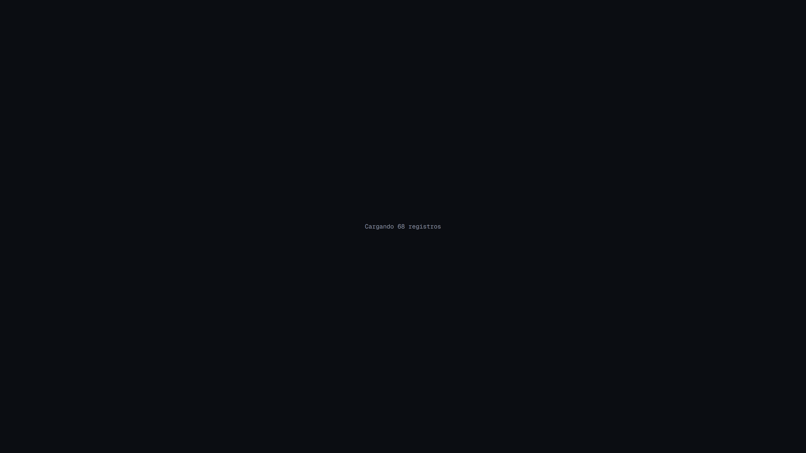

# BATIMIX: Una noche sin dormir no le pasa igual a todos

**Refined Draft Report, Semana 12** · DS5343 Data Visualization, UTEC 2026-2
**Equipo:** Jimena Gurbillon, Andrea Coa, Paolo Medrano
**Fecha:** 28 de octubre de 2026
**Aplicación:** `deliveries/week12/app/` · despliegue previsto en https://andrea-coa.github.io/data-visualization-project/deliveries/week12/app/ (verificar tras el push)

## 1. Narrativa

**Problema.** Ante la misma noche sin dormir, algunas personas se deterioran mucho y otras casi nada. El promedio grupal diluye esa diferencia (Van Dongen et al., 2004). Cui et al. (2026) propusieron un marcador individual: cuánto aumenta la variabilidad de la potencia theta entre épocas de 4 s (σθ) en el EEG de reposo, y reportaron que se asocia con el enlentecimiento en la tarea de vigilancia psicomotora (PVT; ρ = 0.544 frontal, n = 28).

**Audiencia y decisión.** Investigadores en fisiología del sueño que hacen screening exploratorio sobre datos públicos. La herramienta ayuda a decidir qué canales, regiones y covariables merecen una prueba formal. No es diagnóstica ni predictiva.

**Datos.** OpenNeuro ds004902 (Xiang et al., 2024, CC0): 71 personas, sueño normal (NS) frente a 24 a 30 h sin dormir (SD), EEG de 61 canales con ojos abiertos. 68 tienen EEG en ambas condiciones; entre ellas, PVT 30, KSS 32, SSS 33 y PANAS 65.

**Secuencia analítica.** Cada panel responde una pregunta y su título es la respuesta, calculada en vivo con los datos:

| Pregunta | Respuesta (datos reales) | Panel |
|---|---|---|
| ¿Todos cambian igual? | 39 personas se vuelven más inestables y 29 más estables; el promedio sube solo +0.0043 (DE entre personas 0.023) | Franja inferior de la dispersión |
| ¿Dónde cambia, en la cabeza? | σθ: 4 de 61 electrodos con p < 0.05 sin corregir (AF8, Fp2, O2, Oz); μθ: 8; ninguno tras FDR: difuso, sin foco | Matriz de topomapas, columna Δ |
| ¿Cuándo, en los cinco minutos? | SD sobre NS en 52 de 75 épocas; tendencia SD −0.0021 por minuto | Cinco minutos |
| ¿Más inestable es más lento? | ρ = −0.10 [−0.44, 0.27], n = 30: no replica a Cui et al. | Dispersión |
| ¿Depende de cómo se analiza? | En 448 análisis alternativos, ningún estadístico conjunto supera al azar (p ≥ 0.15) | Multiverso |

**Conclusión preliminar.** Sin dormir, la theta de cada persona se mueve en direcciones distintas, y ese cambio no predice de forma robusta quién se deteriora. La única pista consistente es con el ánimo (afecto positivo, PANAS+), no con la vigilancia (PVT).

## 2. Qué cambió desde la Semana 10

| Antes (Semana 10) | Ahora (Semana 12) | Por qué |
|---|---|---|
| Dashboard claro de tres tarjetas separadas, con historia con scroll comentada | Tema oscuro, cuatro paneles sin espacio entre ellos que llenan la pantalla (1365 × 768 sin desplazamiento) | Observación del profesor (sin espacios en blanco) y decisión del equipo (una sola vista, sin scrollytelling) |
| Controles repartidos en varias barras y dentro de cada tarjeta | Un único header con el título y todos los controles | Ruido visual de los controles |
| Textos de ayuda ("arrastra para…", "pasa el cursor…") y etiquetas de rol | Sin textos de instrucciones: el título de cada panel es su hallazgo; intro, glosario y método en "Acerca de" | Ruido visual; pedido del equipo |
| Animaciones de transición y botón Reproducir | Sin animaciones: cada cambio de estado es inmediato | Sin motion graphics |
| Un topomapa con conmutadores σ/μ y NS/SD/Δ | Matriz 2 × 3 de topomapas: columnas NS, SD y Δ; filas σθ y μθ, o las personas A y B elegidas con clic en la dispersión | Comparar condiciones, métricas y personas sin conmutar (T1, T2, T4) |
| Franjas por región de 20 px | Franja de las 68 personas bajo la dispersión, con el conteo 39 / 29 | El hallazgo central necesitaba evidencia visual |
| Selección solo con lazo; ρ fijo de los 68 | Lazo + **Comparar dos grupos** (mujeres vs hombres, orden de sesión, PSQI, vulnerables vs resto), con un color por grupo en las cuatro vistas y ρ por grupo | Tarea T7: los moderadores se ven lado a lado, no filtrados de a uno |
| Vistas que solo mostraban | Todas enlazadas: clic en un electrodo o una ventana de tiempo redefine el eje x de la dispersión; clic en dos puntos compara a dos personas; clic en un análisis del multiverso lo carga | "Todo interactivo": cada vista es también un control |
| Sin forma de llevarse lo visto | Botón **Reporte**: HTML autocontenido con la vista actual, cómo leer cada gráfico, la tabla de personas y su CSV | Que el investigador documente y comparta lo que encontró |
| Títulos largos | Etiqueta de tarea + titular breve calculado con los datos + cifras en tono apagado | Cada panel transmite su mensaje en pocas palabras |
| Marcadores: PVT mediana, KSS, SSS, PANAS | Además PVT lapsos y DE del TR | Basner y Dinges (2011) |
| Sin respuesta a la no replicación | Multiverso de 448 análisis con inferencia por permutación, en una vista limpia: curva sobre la franja del azar y mediana de r por decisión | Diferencial metodológico (sección 4) |

## 3. Justificación del diseño

**Disposición.** Dos columnas sin espacio entre paneles. Izquierda: la matriz de topomapas arriba (mapas de unos 180 px a 1365 × 768) y la serie de cinco minutos debajo. Derecha: la dispersión arriba y el multiverso debajo. Cada gráfico mide su panel y se redibuja si cambia el tamaño, de modo que no quedan huecos. En pantallas angostas los paneles se apilan.

**Tareas y vistas** (tipología de Brehmer y Munzner, 2013):

| Tarea | Pregunta | Vista | Cómo la responde |
|---|---|---|---|
| T1 Localizar | ¿Dónde cambia theta? (Q1) | Matriz, columna Δ | Mapa interpolado (IDW) con anillo (p < 0.05) y relleno (FDR) |
| T2 Comparar métricas | ¿Variabilidad o media? (Q2) | Matriz, filas σθ y μθ | Las dos métricas a la vista, una sobre otra |
| T3 Identificar | ¿Quiénes son vulnerables? (Q3) | Dispersión | Cuadrante ámbar (sobre ambas medianas), lazo y franja de las 68 personas |
| T4 Comparar | ¿Comparten firma espacial? (Q4) | Matriz por grupo; filas A y B | Promedio del grupo activo; dos personas con escalas compartidas |
| T5 Correlacionar | ¿Converge con cada marcador? (Q5) | Dispersión, eje Y | ρ de Spearman con IC 95 % y n en el título, recalculado por grupo |
| T6 Describir tendencia | ¿Cambia dentro del registro? (Q6) | Cinco minutos | Media ± EE por época del grupo activo |
| T7 Comparar grupos | ¿Influyen sexo, PSQI u orden de sesión? (Q7) | Selector Comparar | Dos grupos con dos colores en las cuatro vistas: filas de mapas, ρ por grupo, Δ por época |
| T8 Verificar robustez | ¿Depende de las decisiones analíticas? | Multiverso | Curva sobre la franja del azar, mediana de r por decisión, filtros |

**Codificación y color.** Tema oscuro tipo instrumento: los mapas "brillan" sobre el fondo. NS = cian, SD = magenta. NS y SD comparten una escala secuencial (inferno) por fila para que comparar columnas sea comparar valores; en el modo A / B ambas filas comparten escala. Δ usa una escala divergente cian, oscuro, magenta con el cero fundido en el fondo. Ámbar marca el cuadrante vulnerable. Etiquetas directas (NS y SD al final de las series, conteo 39 / 29 sobre la franja, "análisis inicial" en la curva) en vez de leyendas lejanas.

**Tipografía.** Geist para títulos y texto, Geist Mono para cifras y ejes. Mínimo 10 px en gráficos.

**Interacción.** Lazo libre, clic en dos puntos para A y B, Esc y Limpiar, selector de grupo, región y métrica globales, filtro por decisión y carga de cualquier análisis del multiverso en la dispersión. Respuesta inmediata, sin animación decorativa, estados de foco visibles (principios de Emil Kowalski).

**Accesibilidad.** Contraste AA sobre fondo oscuro, foco visible, selector de grupos como alternativa al lazo, filas del multiverso y curva operables con teclado (flechas + Enter), tabla de datos en "Acerca de" con filas que eligen A y B.

## 4. Diferencial: multiverso explorable

Una sola correlación es una de muchas decisiones posibles. Para responder con honestidad a la no replicación de Cui et al., calculamos **448 especificaciones**: 4 regiones (frontal, centro-temporal, posterior, global) × 2 métricas (σθ, μθ) × 2 formas de cambio (absoluto, relativo) × 7 marcadores conductuales × 2 correlaciones (Spearman, Pearson) × 2 reglas de atípicos (todos, excluir |z| > 2.5). Todas se orientan a deterioro, de modo que la hipótesis predice r > 0.

La inferencia conjunta sigue a Simonsohn, Simmons y Nelson (2020), adaptada a datos observacionales sin covariables: se permutan las filas conductuales entre los 68 sujetos (2000 veces), se recalcula el multiverso completo y se comparan tres estadísticos con su distribución nula. La franja gris de la curva es el 95 % de las curvas permutadas. El diseño explorable (filtrar por decisión, abrir un análisis) sigue a Dragicevic et al. (2019).

| Prueba | Mediana de r | Significativos con r > 0 | Z de Stouffer |
|---|---|---|---|
| Principal, solo σθ (224) | +0.035 (p = 0.32) | 0 | +4.57 (p = 0.22) |
| Multiverso completo (448) | +0.012 (p = 0.42) | 26; el azar llega a 56 (p = 0.15) | +3.13 (p = 0.33) |

Los 26 análisis significativos son todos PANAS+ con μθ: a mayor aumento de potencia theta, mayor caída del afecto positivo. Es la única señal consistente, pero no supera al azar en conjunto: queda como hipótesis. El análisis inicial de la Semana 6 se reproduce exacto (ρ = −0.099) y el Δσθ frontal recalculado coincide con `merged_summary.csv` (diferencia máxima 2.8e−17).

**Por qué podría no replicar** (`research/literatura_verificada.md`): Cui et al. usaron referencia promedio, ICA, filtro de 1 a 30 Hz, denominador de 4 a 30 Hz, rechazo de épocas y limpieza de tiempos de reacción, con n = 28; nosotros, referencia FCz, sin ICA, denominador de 1 a 40 Hz y n = 30. Con n = 30 la probabilidad de detectar ρ = 0.3 es cercana a 0.35.

## 5. Hallazgos preliminares

1. La respuesta es individual: 39 personas aumentan su variabilidad theta y 29 la reducen; el promedio casi no se mueve.
2. El cambio espacial es difuso: ningún electrodo sobrevive FDR, ni en σθ ni en μθ.
3. La elevación de theta en SD es leve y sostenida a lo largo de los cinco minutos.
4. La inestabilidad theta no predice el enlentecimiento en el PVT (ρ = −0.10, n = 30), tampoco con lapsos (ρ = −0.01).
5. El resultado no depende de una decisión analítica: en todo el multiverso ningún estadístico conjunto supera al azar.

## 6. Limitaciones

- n bajo para la conducta (PVT 30), con poca potencia estadística.
- Preprocesamiento heurístico: sin ICA, sin re-referenciar, detección de canales malos por varianza.
- Las pruebas por electrodo con subgrupos no se muestran (n pequeño); los grupos pequeños son exploratorios.
- La versión 1.0.8 del dataset actualizó un archivo de `sub-01` que la Semana 6 marcó como corrupto: hay que volver a descargarlo.
- Xiang et al. (2024) parecen asignar los valores t del PVT a indicadores distintos de los del diccionario del dataset; seguimos el diccionario.
- Evaluación con usuarios todavía pendiente.

## 7. Conectividad funcional: evaluada y postergada

Evaluamos añadir una vista de conectividad entre electrodos (`research/informe_conectividad.md`). Recomendación: **descartar para las tres semanas finales** y dejarla como trabajo futuro. El estudio más parecido (Verweij et al., 2014) no halló cambios de conectividad con ojos abiertos; nuestro pipeline (referencia FCz, sin ICA, sin canales EOG) no es adecuado para conectividad; y con 1830 aristas y n = 68 el efecto mínimo detectable es grande (d_z cercano a 0.65). En la matriz de decisión, *sin conectividad* obtiene 29 de 40 frente a 24 del grafo coordinado con el mapa.

## 8. Trabajo restante y responsables

| Semana | Jimena Gurbillon | Andrea Coa | Paolo Medrano | Todo el equipo |
|---|---|---|---|---|
| 13 (29 oct a 4 nov) | Re-ejecutar el pipeline con referencia promedio e ICA (estilo Cui) y añadirlo como dimensión del multiverso | Resumen de moderadores; guion del teaser | Criterio de vulnerabilidad por lapsos (Chua et al., 2019); redacción de Resultados | Despliegue en GitHub Pages; prueba informal con 3 a 5 usuarios (tareas T1 a T8) |
| 14 (5 a 11 nov) | Datos y métodos del paper; póster | Video de presentación (5 min) y teaser (1 min) | Diseño y resultados del paper; figura de abstract gráfico | Paper completo en plantilla IEEE VIS (LaTeX); incorporar hallazgos de usabilidad |
| 15 (12 a 18 nov) | Pulido del mapa | Página del proyecto final | Pulido del multiverso | README final, contribuciones, reflexión, prueba de enlaces, exhibición |

## Referencias

Las referencias completas, con DOI verificado, están en `research/literatura_verificada.md`. Citadas aquí: Basner y Dinges (2011), Brehmer y Munzner (2013), Chua et al. (2019), Cui et al. (2026), Dragicevic et al. (2019), Simonsohn, Simmons y Nelson (2020), Van Dongen et al. (2004), Verweij et al. (2014), Xiang et al. (2024).

*Uso de IA: parte del código, del análisis de multiverso y de la redacción se desarrolló con asistencia de Claude (Anthropic) y fue revisada por el equipo.*
