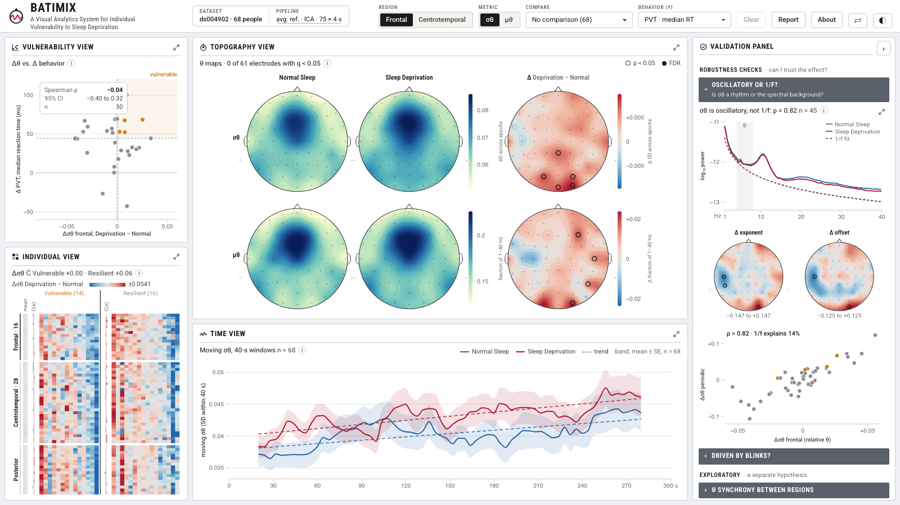

# BATIMIX: One sleepless night does not affect everyone the same way

**Refined Draft Report, Week 12** · DS5343 Data Visualization, UTEC 2026-2
**Team:** Jimena Gurbillon, Andrea Coa, Paolo Medrano
**Date:** 28 October 2026 (updated 2 November 2026)
**Application:** `deliveries/week12/app/` · planned deployment at https://andrea-coa.github.io/data-visualization-project/deliveries/week12/app/ (verify after the push)

## 1. Narrative

**Problem.** After the same sleepless night, some people deteriorate a lot and others barely at all. The group average dilutes that difference (Van Dongen et al., 2004). Cui et al. (2026) proposed an individual marker: how much the variability of theta power across 4-s epochs (σθ) increases in resting EEG, and reported that it is associated with slowing on the psychomotor vigilance task (PVT; ρ = 0.544 frontal, n = 28).

**Audience and decision.** Sleep physiology researchers doing exploratory screening on public data. The tool helps decide which channels, regions and covariates deserve a formal test. It is neither diagnostic nor predictive.

**Data.** OpenNeuro ds004902 (Xiang et al., 2024, CC0): 71 people, normal sleep (NS) versus 24–30 h without sleep (SD), 61-channel eyes-open EEG. 68 have EEG in both conditions; of these, PVT 30, KSS 32, SSS 33 and PANAS 65.

**Analytic sequence.** Each panel answers one question and its title is the answer, computed live from the data:

| Question | Answer (real data) | Panel |
|---|---|---|
| Does everyone change the same way? | 40 people become more unstable and 28 more stable; the mean rises only +0.0030 (SD across people 0.022) | Scatter and heatmap |
| Where does it change on the head? | σθ: 5 of 61 electrodes with uncorrected p < 0.05 (CPz, O2, Oz, PO3, PO4); μθ: 4; none after FDR: diffuse, no focus | Topomap matrix, Δ column |
| When, within the five minutes? | Moving σθ in SD above NS in 60 of 66 windows (frontal) | Five minutes |
| Is more unstable slower? | ρ = −0.04 [−0.40, 0.32], n = 30: does not replicate Cui et al. | Scatter |
| Is the effect oscillatory or 1/f? | The change in σθ tracks the change in periodic theta (ρ = 0.82 frontal, 0.89 centrotemporal) | Secondary view «Oscillatory or 1/f?» |
| Does it depend on how it is analyzed? | Across 896 alternative analyses (two preprocessing pipelines), no joint statistic exceeds chance (p ≥ 0.09) | About, «Robustness» (section 4) |

**Preliminary conclusion.** Without sleep, each person's theta moves in different directions, and that change does not robustly predict who deteriorates. The only consistent hint is with mood (positive affect, PANAS+), not with vigilance (PVT).

## 2. What changed since Week 10

| Before (Week 10) | Now (Week 12) | Why |
|---|---|---|
| Light dashboard of three separate cards, with a commented scrolling story | Single view with gapless panels that fill the screen (1365 × 768 without scrolling); light theme by default, dark as an option | Instructor feedback (no white space) and team decision (one view, no scrollytelling) |
| Controls spread over several bars and inside each card | One header with the title and all controls | Visual noise from controls |
| Help text ("drag to…", "hover…") and role labels | No instruction text: each panel title is its finding; intro, glossary and method in About | Visual noise; team request |
| Transition animations and a Play button | No animations: every state change is immediate | No motion graphics |
| Inverse-distance (IDW) maps on hand-approximated 2D coordinates | Biharmonic v4 interpolation, as in EEGLAB `topoplot` and FieldTrip `ft_topoplotER`, on the real positions in `electrodes.tsv` in azimuthal equidistant projection; since 2 November it is the only method in the app (the selector that also showed MNE's Clough-Tocher cubic and the spherical spline, Perrin et al., 1989, was removed). All three implementations reproduce the originals (EEGLAB and FieldTrip in MATLAB R2022a, MNE 1.8) with an error below 1e-9 of the range. With all 68 people, the v4 map correlates r ≥ 0.985 with MNE's cubic and r ≥ 0.93 with the spherical spline in all six maps | IDW is not a standard for EEG topomaps; use the community's reference method and show that the pattern does not depend on it |
| No indication of pipeline or units; electrode tooltip with p and q | Fixed chip in the header (now θ 4–8 / 1–40 Hz · avg. ref. · ICA · 75 × 4 s, linked to the method); units on the color bars; the five-minute band labeled «mean ± SE»; tooltip with t(67), d_z and 95% CI of Δ. The Δ map of the 68 is now paired and p uses the exact t distribution (formerly a normal approximation); same conclusions | The first questions of a neurophysiologist: which pipeline, which units, what effect size |
| Five minutes always showed the mean (μθ), even with σθ selected | Follows the σθ/μθ button: with σθ it shows moving σθ (SD of regional θ in 40-s windows sliding by one epoch). Exploratory and labeled: its scale is smaller than the scatter σθ because it starts from the region-averaged series | Q6 for the central metric: the state-instability hypothesis (Doran, Van Dongen and Dinges, 2001) predicts more moment-to-moment variability without sleep; Cui et al. (2026) summarize it as a single number without temporal order; 40 s is where resting spectral power reaches its reliability (Gudmundsson et al., 2007) |
| Two columns with maps and views of the same size; no secondary views | Three columns with the topomap as the main view and a column of collapsible secondary views: «Oscillatory or 1/f?» (specparam) and «θ synchrony between regions» (wPLI graph and effect per pair), computed from the raw EEG with `tools/build_secondary.py` and linked to the selection | Visual hierarchy (instructor critique) and the first objection a neurophysiologist would raise: is it oscillation or 1/f background? |
| No automatic verification of the numbers | `tools/check_app.py`: 16 tests (FDR and ρ against statsmodels and scipy, t and d_z against scipy, reference signals with MNE, consistency of n across titles, About, Report and tooltip, secondary views, screenshots) and `tools/check_reproduction.py` (the processed data reproduce from the raw EEG) | A miscalculated number invalidates the tool for an expert |
| One topomap with σ/μ and NS/SD/Δ toggles | 2 × 3 topomap matrix: NS, SD and Δ columns; σθ and μθ rows, or one row per person when exactly two people are selected | Compare conditions, metrics and people without toggling (T1, T2, T4) |
| Selection with the lasso only; fixed ρ for the 68 | Lasso, click selection from 1 to n people, and **Compare two groups** (women vs men, session order, PSQI, vulnerable vs rest), with one color per group in every view and ρ per group | Task T7: moderators side by side, not filtered one at a time |
| Views that only displayed | All linked: clicking an electrode or a time window redefines the scatter x-axis; clicking points or heatmap columns builds the selection; two selected people are compared side by side | "Everything interactive": each view is also a control |
| No per-person view | Fixed person × electrode heatmap: two groups defined by behavior only (deteriorate vs resist, or the Compare groups) and their consistency C(e); selected people are outlined without reordering | Tasks T3 and T4 without averages: do those who deteriorate share a signature? |
| No way to take the view away | **Report** button: self-contained HTML with the current view, how to read each chart, the people table and its CSV | Let the researcher document and share what they found |
| Long titles | Short headline computed from the data plus figures in a muted tone | Each panel conveys its message in a few words |
| Markers: median PVT, KSS, SSS, PANAS | Also PVT lapses and RT SD | Basner and Dinges (2011) |
| No response to the non-replication | Multiverse (448 analyses, now 896 with the preprocessing pipeline as a dimension) with permutation inference. It had its own panel in the 28 October delivery; later, to reduce the number of charts, it moved to About and the Report as a robustness analysis | Methodological contribution (section 4) |
| No per-person data quality; no artifact check | Tooltip with each person's EEG quality (epochs used, interpolated channels, blinks per minute) and a secondary «Driven by blinks?» view (`tools/build_quality.py`) | Without EOG or ICA, the first suspicion about frontal theta is blinks |
| Preprocessing without ICA, FCz reference (the first question of a reviewer; every recent multi-channel sleep-deprivation study uses ICA) | Main pipeline with average reference and ICA (`tools/eeg_ica.py`); all app data regenerated; the Week 6 pipeline kept as a multiverse dimension; Cui-style rerun (`tools/build_cui_variant.py`) | Snipes et al. (2022), Lian et al. (2023), Ma et al. (2023), Liu, Xie and Ma (2024), Cui et al. (2026); see References |
| Spanish interface | English interface | The tool and its figures will be part of an English paper |

## 3. Design rationale

**Layout.** Three columns, following the team's sketch and the most common pattern in IEEE VIS systems (Chen et al.: large views in the center, narrow side panels). Since 2 November each view is a box with a short uppercase name and an icon (Vulnerability, Individual, Topography and Time views; Validation Panel), the finding moves to a discreet subtitle, controls carry a label above them, the header has the system name, a one-line description and a dataset summary, and conditions are written out as Normal Sleep and Sleep Deprivation, following VISTA and Unlearning Comparator. Center: the topomap matrix, the main view, with the five-minute series below, wide enough for its 75 epochs. Left: the people, with a compact scatter and a tall heatmap. Right: secondary views in an accordion (one open at a time) that collapse to a strip to give the maps more room. The ⇄ button swaps the sides; the center does not move. On narrow screens the panels stack, maps first.

**Tasks and views** (typology of Brehmer and Munzner, 2013):

| Task | Question | View | How it answers |
|---|---|---|---|
| T1 Locate | Where does theta change? (Q1) | Matrix, Δ column | Interpolated map (EEGLAB/FieldTrip v4) with ring (p < 0.05) and fill (FDR) |
| T2 Compare metrics | Variability or mean? (Q2) | Matrix, σθ and μθ rows | Both metrics in view, one above the other |
| T3 Identify | Who is vulnerable? (Q3) | Scatter; heatmap | Amber quadrant (above both medians), lasso and click selection; one column per person |
| T4 Compare | Do they share a spatial signature? (Q4) | Matrix by group; two selected people; heatmap | Mean of the active group; two people with shared scales; C(e) per group |
| T5 Correlate | Does it converge with each marker? (Q5) | Scatter, Y-axis | Spearman ρ with 95% CI and n in the title, recomputed per group |
| T6 Describe trend | Does it change within the recording? (Q6) | Five minutes | With μθ, mean ± SE per epoch; with σθ, moving σθ in 40-s windows |
| T7 Compare groups | Do sex, PSQI or session order matter? (Q7) | Compare selector | Two groups with two colors in every view: map rows, ρ per group, Δ per epoch |
| T8 Check robustness | Does it depend on analytic decisions? Is it oscillatory? | About, «Robustness»; secondary views | Joint multiverse statistics with their permutation p; periodic vs aperiodic separation; θ synchrony with effects and CIs per pair |

**Encoding and color.** Light theme by default with ColorBrewer palettes; an optional dark "instrument" theme. NS = blue, SD = red. NS and SD share a sequential scale per row so that comparing columns means comparing values; with two people both rows share the scale. Δ uses a diverging scale with a neutral zero. Amber marks the vulnerable quadrant. Selection is marked with a ring (scatter) or an outline (heatmap) without changing the point colors, which keep their meaning. Direct labels instead of distant legends.

**Typography.** Geist for titles and text, Geist Mono for figures and axes. At least 9–10 px in charts.

**Interaction.** Lasso, click to add or remove people (1 to n), Shift + click for people A and B, Esc and Clear, group selector, global region and metric; the ⤢ button of each view opens it almost full screen (Esc restores it); choosing an electrode (a map or a heatmap row) also switches the time view from the region to that electrode's own series, with its larger scale, so a local effect can be checked over the five minutes. Immediate response, no decorative animation, visible focus states.

**Accessibility.** AA contrast, visible focus, group selector as an alternative to the lasso, data table in About.

## 4. Contribution: a multiverse of 896 analyses

A single correlation is one of many possible decisions. To respond honestly to the non-replication of Cui et al., we computed **896 specifications**: 2 preprocessing pipelines (average reference with ICA, the main one, or FCz reference without ICA, Week 6) × 4 regions (frontal, centrotemporal, posterior, global) × 2 metrics (σθ, μθ) × 2 forms of change (absolute, relative) × 7 behavioral markers × 2 correlations (Spearman, Pearson) × 2 outlier rules (all, exclude |z| > 2.5). All are oriented toward deterioration, so the hypothesis predicts r > 0.

Joint inference follows Simonsohn, Simmons and Nelson (2020), adapted to observational data without covariates: the behavioral rows are permuted among the 68 participants (2000 times), the whole multiverse is recomputed, and three statistics are compared with their null distribution. The threshold of each statistic is the 95th percentile of its permuted distribution. In the 28 October delivery it had an explorable panel (Dragicevic et al., 2019); to reduce the number of charts, the team removed it from the board and kept it as a robustness analysis in About and in the Report, with all results in `data/multiverse_specs.csv`.

| Test | Median r | Significant with r > 0 | Stouffer Z |
|---|---|---|---|
| Main, σθ only (448) | +0.089 (p = 0.11) | 11; chance reaches 63 (p = 0.31) | +11.09 (p = 0.09) |
| Full multiverse (896) | +0.053 (p = 0.19) | 58; chance reaches 106 (p = 0.13) | +10.80 (p = 0.16) |

Of the 58 significant analyses, 48 are PANAS+ (22 with ICA, 26 without): the larger the increase in theta, the larger the drop in positive affect. With ICA, 10 analyses with subjective sleepiness (SSS) also appear; none with the PVT in either pipeline. It is the only consistent signal, but it does not exceed chance jointly: it remains a hypothesis. The recomputed frontal Δσθ matches `merged_summary.csv` of each pipeline (maximum difference 4e−17).

**Why it might not replicate** (`research/literatura_verificada.md`): Cui et al. used average reference, ICA, a 1–30 Hz filter, a 4–30 Hz denominator, epoch rejection and reaction-time cleaning, with n = 28; our Week 6 pipeline used FCz reference, no ICA, a 1–40 Hz denominator and n = 30; the main pipeline now uses average reference and ICA (finding 10). With n = 30, the probability of detecting ρ = 0.3 is close to 0.35. **We tested this directly** (`tools/build_cui_variant.py`): rerunning the raw EEG with their pipeline (1–30 Hz, average reference, extended Infomax ICA at 99% variance removing ocular components by |r| > 0.85 with Fp1/Fp2 and muscle components by ICLabel p > 0.85, 200 µV epoch rejection, 4–30 Hz denominator) removes 2.4 components per recording (Cui: 2.6 to 3.1) and keeps 69 of 75 epochs, yet ΔσΘ still does not track ΔPVT: ρ = −0.06 frontal and −0.01 centrotemporal (n = 30), and no subset of 28 people (all 435 ways of leaving two out) exceeds ρ = 0.14. The pipeline does not explain the non-replication; the PVT variable (Cui likely recomputed median RT from trials) or sampling remain.

## 5. Preliminary findings

1. The response is individual: 40 people increase their theta variability and 28 reduce it; the mean barely moves.
2. The spatial change is diffuse: no electrode survives FDR, in σθ or in μθ.
3. The theta elevation in SD is mild and sustained across the five minutes.
4. Theta instability does not predict PVT slowing (ρ = −0.04, n = 30), nor lapses (ρ = 0.07).
5. The result does not depend on an analytic decision: across the whole multiverse no joint statistic exceeds chance.
6. Person by person there is no vulnerability signature either (figures from the Week 6 pipeline): with the PVT, those who deteriorate and those who resist have mean consistency C = −0.02 and +0.10, and in a similarity graph (analyzed in the delivery, now off the board) 19 of 42 neighbors of those who deteriorate belong to their group (chance ≈ 19). The exception is again mood: those who lose positive affect increase theta more (C = +0.28 versus −0.01 in σθ; +0.35 versus −0.07 in μθ), although their patterns are not more similar to each other.
7. **σθ is oscillatory, not an effect of the 1/f background.** Each person's change in σθ tracks the change in their periodic theta (ρ = 0.82 frontal, 0.89 centrotemporal). Without ICA, deprivation seemed to raise the aperiodic offset (d_z = +0.26, p = 0.034; as Bai et al., 2024, report on this dataset); after ICA it does not (offset d_z = +0.01, p = 0.97; exponent d_z = +0.04, p = 0.73), which suggests that part of that change was ocular or muscle artifact. 53% of electrodes show a theta peak, as Monchy et al. ask to verify before interpreting theta.
8. **Blinks do not drive σθ.** ICA removes the ocular components; this check asks whether what is left still matters. Blinks detected on Fp1/Fp2 of the raw EEG do not change with deprivation (median 19.6 → 19.9 per minute, p = 0.60). Removing the 1-s windows within 0.25 s of a blink leaves each person's Δσθ almost unchanged (ρ = 0.95 frontal, 0.96 centrotemporal, n = 48), and within recordings epochs with more blinks do not have more theta (r = −0.05). People whose blink rate rose more do show a larger Δσθ (ρ = 0.34, p = 0.005); since removing the blinks does not change Δσθ, this is more likely a shared cause (drowsiness raises both) than contamination.
9. **Theta synchrony between regions (exploratory).** With average reference and wPLI², it decreases in 44 of 45 region pairs after deprivation, but no pair survives FDR (sign-flip permutation joint test p = 0.14) and it is unrelated to the PVT.
10. **Average reference and ICA (main pipeline since November 2026) do not change the conclusions.** ICA removes 5.1 components per recording (2.5 ocular, 2.6 muscle) and 71 of 75 epochs are kept. The frontal group increase in σθ is t = 1.12 (p = 0.27; Week 6 pipeline 1.54, p = 0.13), each person's Δσθ agrees with the Week 6 value (ρ = 0.64 frontal, 0.87 centrotemporal), and the link with ΔPVT stays null. Copying Cui et al. exactly (1–30 Hz, 4–30 Hz denominator) raises the frontal group effect (t = 2.32, p = 0.023), mostly through the denominator, but not the link with the PVT (section 4).

## 6. Limitations

- Small n for behavior (PVT 30), with low statistical power.
- Automatic preprocessing: ICA components are selected by rule (Fp1/Fp2 correlation and ICLabel), without the visual review used by Snipes et al. (2022) or Ma et al. (2023); bad channels by variance and, after ICA, by amplitude. The Week 6 pipeline without ICA is kept as a dimension of the multiverse.
- Per-electrode tests are not shown for subgroups (small n); small groups are exploratory.
- Three eyes-open recordings (`sub-01`, `sub-28` and `sub-44`, session 2) are truncated in the OpenNeuro bucket and MNE cannot read them; this was verified with a download on 2 November 2026, so downloading again does not fix them.
- Xiang et al. (2024) appear to assign the PVT t values to indicators different from those in the dataset dictionary; we follow the dictionary.
- The trial-level PVT files of ds004902 are not consistent with the dataset summary columns (median RT matches in 11 of 66 sessions) and, with the session-to-condition mapping used for the EEG, only 11 of 29 people are slower after deprivation; we therefore use only the summary columns (`app/tools/check_pvt_trials.py`). The PVT was recorded separately from the resting EEG, which has no event markers, so no ERP or time-locked analysis is possible.
- User evaluation still pending.

## 7. Functional connectivity: from postponed to an exploratory secondary view

In Week 12 we ruled it out for the main board (`research/informe_conectividad.md`): the most similar study (Verweij et al., 2014) found no changes with eyes open, our Week 6 pipeline used FCz reference, and 1830 edges required large effects. The condition that the report itself set for reopening it was met: we downloaded the raw EEG and verified that the pipeline reproduces it. We therefore computed it with the safeguards from the literature (FCz re-inserted, average reference and ICA, debiased wPLI², 10 regions and 45 pairs, FDR and permutation) and show it only as an exploratory secondary view, labeled as such: a head graph and an effect-per-pair plot with 95% CIs. The result is a consistent trend without significant pairs, and at rest theta connectivity may reflect aperiodic activity (Monchy et al.).

## 8. Remaining work and owners

| Week | Jimena Gurbillon | Andrea Coa | Paolo Medrano | Whole team |
|---|---|---|---|---|
| 13 (29 Oct to 4 Nov) | Rerun the pipeline with average reference and ICA (Cui style) and add it as a multiverse dimension (done: main pipeline `tools/eeg_ica.py`, Cui-style rerun `tools/build_cui_variant.py`, multiverse dimension; findings 10 and section 4) | Moderator summary; teaser script | Vulnerability criterion by lapses (Chua et al., 2019); Results writing | Deployment on GitHub Pages; informal test with 3 to 5 users (tasks T1 to T8) |
| 14 (5 to 11 Nov) | Paper data and methods; poster | Presentation video (5 min) and teaser (1 min) | Paper design and results; graphical abstract figure | Full paper in the IEEE VIS template (LaTeX); incorporate usability findings |
| 15 (12 to 18 Nov) | Map polishing | Final project page | Secondary views and ML polishing | Final README, contributions, reflection, link check, exhibition |

## References

Full references with verified DOIs are in `research/literatura_verificada.md` (in Spanish). Cited here: Bai et al. (2024), Basner and Dinges (2011), Brehmer and Munzner (2013), Chen et al. (multiple-view composition patterns), Chua et al. (2014, 2019), Cui et al. (2026), Delorme (2023), Doran, Van Dongen and Dinges (2001), Dragicevic et al. (2019), Gudmundsson et al. (2007), Li (2026), Lian et al. (2023), Liu, Xie and Ma (2024), Ma et al. (2023), Monchy et al. (aperiodic functional connectivity), Perrin et al. (1989), Pion-Tonachini et al. (2019), Simonsohn, Simmons and Nelson (2020), Snipes et al. (2022), Van Dongen et al. (2004), Verweij et al. (2014), Vinck et al. (2011), Xiang et al. (2024).

**Preprocessing benchmark (main pipeline since November 2026).** The EEG pipeline (average reference and ICA) follows the sleep-deprivation EEG studies whose methods we read in full text:

| Study | Reference | Filter | Artifact removal |
|---|---|---|---|
| Chua et al. (2014), *Sleep* 37(1):27–39, doi:10.5665/sleep.3302 | mastoids | 0.3–35 Hz | manual inspection (single channel, Cz); SD of spectral power across 2-s epochs, the closest metric to σθ |
| Snipes et al. (2022), *J Neurosci* 42(45):8569–8586, doi:10.1523/JNEUROSCI.1063-22.2022 | average | 0.5–40 Hz | ICA, ICLabel plus visual review |
| Lian et al. (2023), *Brain Sci* 13(6):949, doi:10.3390/brainsci13060949 | average | 0.1–70 Hz | ICA (ocular and muscle) |
| Ma et al. (2023), *Front Neurosci*, doi:10.3389/fnins.2023.1204457 | average | 0.1–40 Hz | ICA (manual, 6.1 components) and ±100 µV |
| Liu, Xie and Ma (2024), *Nat Sci Sleep* 16:1937–1948, doi:10.2147/NSS.S485412 | mastoids | 0.3–80 Hz | ICA (runica, semi-automatic) |
| Cui et al. (2026), *Front Neurosci*, doi:10.3389/fnins.2026.1910878 (ds004902) | average | 1–30 Hz | ICA (Fp1/Fp2 and ICLabel, 0.85) and 200 µV |

Component labels: ICLabel (Pion-Tonachini, Kreutz-Delgado and Makeig, 2019, *NeuroImage* 198:181–197, doi:10.1016/j.neuroimage.2019.05.026). Whether more preprocessing always helps: Delorme (2023), *Sci Rep* 13:2372, doi:10.1038/s41598-023-27528-0. Bai et al. (2024), on this dataset, could not be checked (subscription only). All entries, with what each method section says, are in `research/literatura_verificada.md`, group E.

*Use of AI: part of the code, the multiverse analysis and the writing was developed with the assistance of Claude (Anthropic) and reviewed by the team.*
